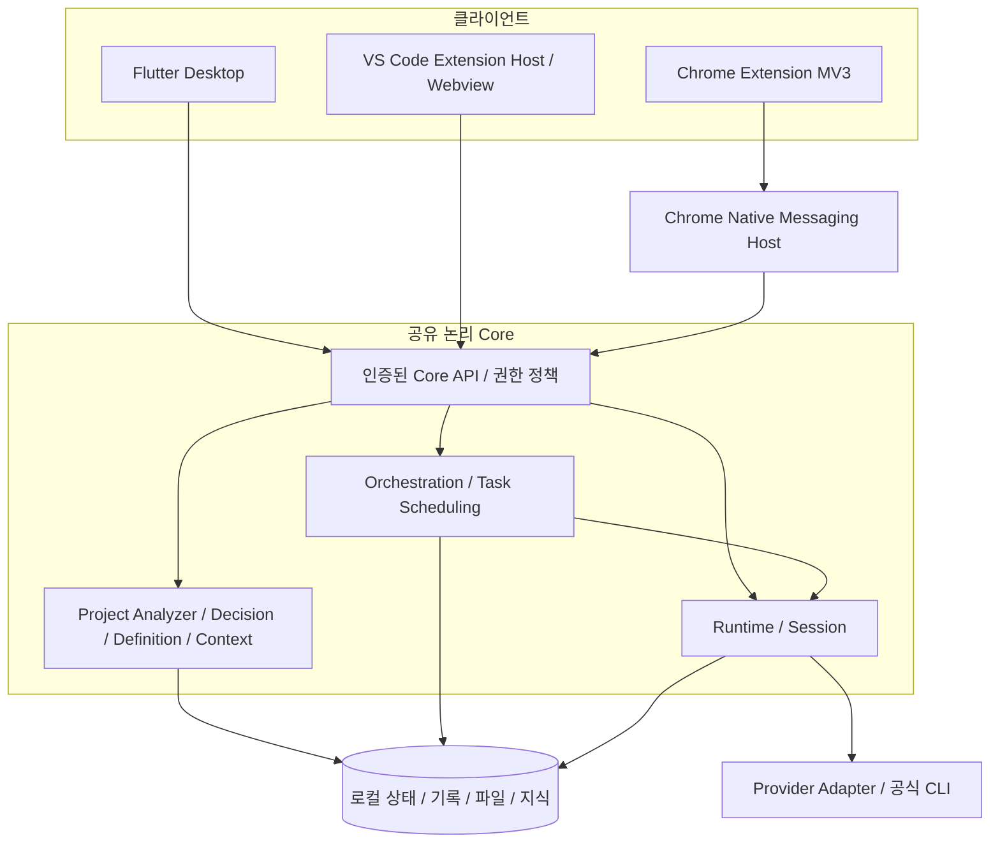

# Local Agent Studio -- 1차 전체 아키텍처 설계 &#40;ARC\-00&#41;  > **버전:** v0.1 · **작성 기준일:** 2026-11-15 · **상태:** 1차 범위 정의 완료 / 상세 설계 미착수 또는 미확정   > **문서 범위:** 제품 목표, 시스템 경계, 논리 계층, 모듈 책임 및 의존성, 공통 데이터 개념, 상위 실행 흐름, 우선 검증사항, 세부 설계서 체계.   > 이 문서는 구현 명세나 검증 완료 보고서가 아닙니다. 기술 및 Provider별 지원 사항은 후속 검증 대상입니다.  ## 1\. 제품 개요  \*\*Local Agent Studio&#40;가칭&#41;\*\*는 사용자가 GUI에서 로컬 프로젝트를 연결하고 자연어로 목표와 제약을 입력하면, 알맞은 AI 에이전트 구조를 추천하고, 이를 수정·검토하여 사용자의 컴퓨터에 설치된 에이전트 실행 환경에서 실행하고 관측하도록 지원하는 **Local\-first 데스크톱 앱**입니다\.  ### 1\.1 제품이 해결할 문제  - 사용자가 에이전트 아키텍처와 구성 파일을 수작업으로 설계해야 하는 부담 - 프로젝트·작업 특성에 맞지 않는 과도한 멀티 에이전트 구성 - 서로 다른 AI CLI 도구의 로그인·실행·세션 관리 방식 차이 - 세션 종료 이후 작업 상태와 근거, 문서 간 결정 사항의 유실 - 에이전트 구성의 품질을 비교하고 개선할 평가 체계 부족  ### 1\.2 목표 사용자와 사용자 경험  - 주요 대상: 로컬 코드베이스나 문서 작업을 에이전트에 위임하려는 사용자, 개발자 및 기술 기획자 - 사용자 흐름: **프로젝트 연결 → 목표·제약 입력 → 아키텍처 추천 → 시각적 검토·수정 → 실행 환경 연결 → 실행·모니터링 → 평가** - 사용자는 API 키 입력 대신 **각 실행 도구가 공식 지원하는 계정 로그인 방식**을 우선 이용할 수 있어야 합니다\. 모든 Provider가 동일하게 지원한다고 가정하지 않습니다\.  ### 1\.3 제품의 핵심 가치  1. **Architecture Designer** -- 프로젝트 분석, 패턴 추천, 시각적 구성 및 설정 내보내기 2. **Agent Runtime Manager** -- 복수 CLI의 탐지, 계정 연결, 세션 및 프로세스 관리 3. **Intelligent Orchestrator** -- 작업 분해, 의존성, 병렬 처리, 검증, 지식 재사용  ## 2\. 1차 범위와 제외 범위  ### 2\.1 1차 설계에 포함  - GUI 주요 화면과 사용자 흐름 정의 - 시스템의 논리 계층, 컴포넌트 책임과 의존 방향 - Provider 중립적인 에이전트 정의 개념 - 외부 CLI 인증을 존중하는 계정 및 실행 관리 경계 - 작업 상태·원본 로그·검증된 결정·장기 기억의 분리 - 평가, 권한 승인, 장애 복구의 시스템 수준 원칙 - 단계적 MVP 범위와 세부 설계 문서 목록  ### 2\.2 현재 단계에서 제외  - 세부 화면 설계 및 픽셀 수준 UI - 정확한 DB DDL, IPC 및 API 스키마, DTO 필드 확정 - 실제 OAuth/CLI 인증 구현과 토큰 포맷 분석 - Provider별 런타임 구현·지원 버전 확정 - 세부 스케줄링 알고리즘, 완전한 Dreaming 워크플로 - 실행 가능한 프로토타입과 성능 측정 완료 주장  **상태 구분:** 이 문서에서 ‘채택’은 설계 방향으로 채택한 것을 뜻하며, 구현·외부 정책 검증 완료를 뜻하지 않습니다\.  ## 3\. 시스템 전체 구성  ```mermaid flowchart TB     UI["01 Presentation -- Flutter Desktop\nWorkspace · Architecture Canvas · Editor\nAccounts · Execution Monitor · Evaluation"]     INT["02 Intelligence\nProject Analyzer · Architecture Decision Engine\nAgent Designer · Context Builder"]     ORCH["03 Orchestration\nTask Scheduler · Dependency Manager\nAgent Coordinator · Review Controller"]     RUNTIME["04 Runtime & Provider\nProvider Registry · Account Manager\nSession Manager · Process Supervisor"]     ADAPTERS["Provider Adapters\nClaude Code · Codex · Antigravity · 기타"]     STORE["05 Persistence & Infrastructure\nSQLite · Git/Worktree · Local Files\nMemory Store · Event Log · OS Secure Storage"]     UI <--> INT     UI <--> RUNTIME     INT --> ORCH     ORCH <--> RUNTIME     RUNTIME --> ADAPTERS     INT <--> STORE     ORCH <--> STORE     RUNTIME <--> STORE ```  > 이 그림은 **논리적 계층**을 나타냅니다. 각 상자가 별도 OS 프로세스 또는 서버라는 의미는 아닙니다. 보안·권한 정책·관측성·오류 복구는 모든 계층에 적용됩니다.  ### 3\.1 계층별 책임과 금지 영역  |계층                          |주요 책임                            |직접 소유하지 않을 책임            | |----------------------------|---------------------------------|-------------------------| |Presentation                |사용자 입력, 설정 변경, 시각화, 실행 결과 확인     |인증 토큰 처리 및 모델 호출 세부사항    | |Intelligence                |프로젝트 분석, 패턴 판단, 구성 제안, 관련 컨텍스트 선택|프로세스 실행·CLI 인증           | |Orchestration               |작업 그래프, 의존성, 작업 배정, 검증 흐름        |Provider 비밀정보 및 자체 로그인 구현| |Runtime & Provider          |설치 탐지, 기능 조회, 인증 상태, 세션·프로세스 수명주기|작업 목표 해석 및 구조 추천         | |Persistence & Infrastructure|작업 상태, 로그, 산출물, 지식 및 보안 저장 수단    |도메인 의사결정                 |  ## 4\. 핵심 모듈 지도  |모듈                               |입력 개념                  |출력 개념                        |비고                        | |---------------------------------|-----------------------|-----------------------------|--------------------------| |Workspace Manager                |프로젝트 폴더, 접근 정책         |Workspace Context            |기존 파일을 무단 변경하지 않음         | |Project Analyzer                 |로컬 코드·문서·목표            |Project Profile              |비밀파일 제외 규칙 필요             | |Architecture Decision Engine     |Profile, 제약, 사용 가능 기능  |Architecture Proposal + 근거   |단일 에이전트 기준선과 비교           | |Agent Designer / Config Generator|승인된 Proposal           |Provider 중립 정의 및 적용 계획       |실제 형식 변환은 Adapter 관련 상세 설계| |Context Builder                  |작업, 결정, 관련 자료          |Task Context                 |필요한 정보만 제공                | |Orchestrator                     |승인된 구성과 작업             |Task DAG, 실행 결정              |병렬화는 의존성 허용 범위 내          | |Provider Registry                |OS 실행 환경               |Provider Capabilities        |설치·버전·기능 탐지               | |Account Manager                  |사용자 연결 요청              |Account Reference/Auth Status|가능한 한 공식 CLI 인증 사용        | |Session / Process Manager        |Task, Provider, Account|Session/Event/Result         |취소, 중단, 복구 상태 구별          | |Memory Manager                   |원본 로그, 검증된 결정          |검색 가능한 지식                    |원본 근거 유지                  | |Evaluator / Policy Engine        |실행 결과, 규칙              |검증 결과, 승인 요청                 |위험 행위에 승인 경계              |  ### 4\.1 의존 방향 원칙  - GUI는 UI 상태를 소유하지만, 외부 CLI의 세부 구현은 알아야 하지 않습니다\. - Intelligence는 Runtime의 **Capability** 정보를 참조할 수 있지만 특정 CLI의 내부 인증 파일에 의존하지 않습니다\. - Orchestration은 공통 실행 계약을 통해 Runtime을 호출합니다\. - Provider별 모델·인증·세션 기능 차이는 Adapter의 지원 기능 메타데이터로 표현합니다\. - Persistence는 작업 상태의 원본을 제공하며, 메모리 요약은 작업 상태의 유일한 원본이 될 수 없습니다\.  ## 5\. 핵심 사용자 흐름  ```mermaid flowchart TD     A[프로젝트 선택 및 목표 입력] --> B[프로젝트 분석]     B --> C[단순 구성부터 아키텍처 추천]     C --> D{GUI에서 사용자 승인?}     D -->|수정| C     D -->|승인| E[Provider·계정·권한·설치 상태 확인]     E --> F[작업 및 의존성 그래프 생성]     F --> G[런타임 세션 실행]     G --> H[로그·산출물 저장]     H --> I[평가 및 정책 검사]     I --> J{충족?}     J -->|재작업 허용| F     J -->|완료| K[확정된 결정·산출물 기록]     K --> L[선택적 메모리 갱신]     L --> M[사용자 결과 확인] ```  - 모든 반복은 **재시도 횟수, 비용 또는 실행 시간 상한**을 갖습니다\. - 승인 요청이 필요한 행위는 허가 전 실행하지 않습니다\. - 사용자가 중단하거나 앱이 종료된 경우에도 **미완료/중단/실패**를 구분해 저장합니다\.  ## 6\. Provider 인증 및 실행 전략  ### 6\.1 도구와 모델을 구분  - **Model:** Claude, GPT, Gemini 등 추론 모델 - **Runtime/Agent Tool:** Claude Code, Codex, Antigravity 등 작업 수행 환경 - **Account:** 런타임이 공식적으로 지원하는 인증 주체 - **Session:** 특정 작업·계정·실행 환경에서 시작한 실행 시도  이 네 개를 하나의 `provider` 문자열로 합치지 않습니다\.  ### 6\.2 계정과 세션 격리  - Orca의 공개 구조와 CLI 기반 계정 관리 경험은 **참고 모델**로 사용합니다\. - 공식 로그인 또는 공식적으로 허용된 인증 경로를 우선 사용합니다\. - 앱은 인증 토큰·쿠키를 임의 추출하거나 비공식 구독 인증 재사용을 기본 기능으로 삼지 않습니다\. - 계정 전환이 다른 작업의 전역 설정을 변경하지 않도록 **세션별 계정 참조 및 독립 실행 환경**을 목표로 합니다\. - 실제 격리 지원 여부와 로그인 방식은 Provider마다 검증해야 합니다\. 지원하지 않는 기능은 GUI에서 비활성화하거나 대안을 표시합니다\. - Git Worktree는 파일 충돌 완화 수단이며 OS 보안 샌드박스가 아닙니다\.  ### 6\.3 공통 Runtime 계약의 추상 수준  - 설치/버전/기능 탐지 - 인증 상태 조회 및 공식 로그인 시작 - 계정 참조와 실행 환경 선택 - 세션 시작, 이벤트 조회, 취소, 종료 - 지원 시 재개/복구 - 오류 코드와 사용자에게 제시할 복구 조치 반환  정확한 함수 시그니처, 이벤트 형식, 인증 저장 경로는 ARC\-05/06에서 확정합니다\.  ## 7\. Architecture Decision Engine의 원칙  추천 가능한 패턴은 Single Augmented LLM, Prompt Chaining, Routing, Parallelization, Orchestrator--Workers, Evaluator--Optimizer 및 필요한 Agent Loop의 조합입니다\.  |작업 특징                |우선 검토 구조            | |---------------------|--------------------| |단일 작업 + 도구로 충분       |Single Agent        | |순차적이고 단계가 고정         |Prompt Chaining     | |입력 유형마다 처리 방식 상이     |Routing             | |독립 작업 병렬 가능          |Parallelization     | |하위 작업을 실행 중 동적으로 결정  |Orchestrator--Workers| |객관적 품질 평가와 개선 루프 필요  |Evaluator--Optimizer | |장기간 반복되며 세션을 넘는 지식 필요|Memory + 상태 관리      |  추천 결과에는 **선택한 구조, 이유, 더 단순한 대안, 비용·지연·정확성 관련 가정, 검증할 실패 사례**를 포함합니다\. LLM의 추천과 명시적 규칙·검증 로직을 분리합니다\. 복잡성 증가는 측정 가능한 필요가 있을 때만 채택합니다\.  ## 8\. 상태·지식·산출물의 분리  |구분                   |대표 저장 수단(제안)        |정본 역할                   | |---------------------|--------------------|------------------------| |Operational State    |SQLite              |작업 상태, 의존성, 실행 시도, 승인 이력| |Source / Transcripts |이벤트 로그·원본 기록        |사후 검증 근거                | |Decisions / Knowledge|Markdown 또는 구조화된 저장소|승인된 결정 및 재사용 규칙         | |Artifacts            |로컬 파일 + Git         |생성 파일·버전·변경 이력          | |Memory Index         |Markdown/검색 인덱스     |관련 지식 발견 및 선택적 주입       | |Credentials          |공식 CLI 저장소/OS 보안 저장소|민감정보 보관, 일반 DB 제외       |  \*\*Dreaming&#40;사후 메모리 정리&#41;\*\*은 향후 검증된 지식의 중복 통합·오류 수정·인덱스 갱신으로 도입하되, 근거 없는 자동 확정이나 원본 기록 삭제를 기본 동작으로 삼지 않습니다\.  ## 9\. 핵심 도메인 개념  |엔터티                       |의미                   | |--------------------------|---------------------| |Project                   |분석 대상 로컬 작업 공간과 목표   | |Architecture              |선택된 패턴과 작업 실행 구성     | |AgentDefinition           |역할·도구·권한·입출력 원칙      | |Runtime / Provider        |실행 도구와 지원 Capability | |Account                   |공식 인증 주체에 대한 참조      | |Task                      |작업 상태 및 의존성          | |Session / ExecutionAttempt|특정 작업의 실제 실행 기록      | |Artifact                  |산출물·경로·버전·검증 상태      | |MemoryEntry               |근거와 유효 상태가 있는 재사용 지식 | |Evaluation                |성공 기준, 점수, 피드백, 검증 근거|  ```mermaid flowchart LR     P[Project] --> A[Architecture]     A --> D[AgentDefinitions]     P --> T[Tasks / Dependencies]     T --> S[Execution Attempts / Sessions]     S --> R[Runtime + Account]     S --> F[Artifacts / Git]     S --> E[Evaluations]     P --> M[Memory Entries] ```  구체적인 카디널리티와 물리 데이터 모델은 상세 설계에서 확정합니다\.  ## 10\. GUI 범위 &#40;정보 구조&#41;  1. **Workspace Dashboard:** 프로젝트 생성·연결·최근 실행 2. **Setup / Constraints:** 목표, 비용, 시간, 프라이버시, 오프라인 요구 3. **Architecture Recommendation:** 추천 패턴, 선택 근거, 더 단순한 대안 4. **Architecture Canvas / Agent Editor:** 역할·모델·런타임·도구·권한 수정 5. **Connected Services:** 설치 탐지, 공식 로그인, 지원 기능, 연결 상태 6. **Execution Monitor:** 작업 DAG, 진행/실패/취소, 로그·산출물 7. **Evaluation:** 기준선 대비 품질, 실행 시간, 비용/사용량 가용 범위  초기 화면은 대시보드, 설계, 실행을 우선하고 계정 연결과 평가 화면은 단계적으로 확장할 수 있습니다\.  ## 11\. 기술 방향 및 Architecture Decision Records  |ID     |1차 방향                            |확정 상태             | |-------|---------------------------------|------------------| |ADR-001|Local-first 데스크톱 앱               |설계 방향 채택          | |ADR-002|Flutter Desktop GUI              |설계 방향 채택          | |ADR-003|로컬 코어 서비스/모듈형 모놀리스               |언어·IPC 추후 결정      | |ADR-004|Provider 중립 Agent Schema와 Adapter|설계 방향 채택          | |ADR-005|공식 인증 흐름 우선, 사용자 API 키 입력 최소화    |Provider 정책 검증 필요 | |ADR-006|SQLite를 작업 상태 저장소 후보로 사용         |세부 스키마 미확정        | |ADR-007|로컬 산출물 + Git, 필요 시 Worktree      |격리 방식 검증 필요       | |ADR-008|상태, 원본 기록, 검증된 결정, 장기 기억 분리      |설계 방향 채택          | |ADR-009|위험 작업은 권한 제한 및 사용자 승인            |상세 정책 미확정         | |ADR-010|단일 에이전트 기준선과 구성 비교               |지표·데이터셋 미확정       | |ADR-011|세션 상태와 체크포인트 기반 복구               |Provider별 가능 여부 확인| |ADR-012|실행·인증 기능을 Capability로 표현         |스키마 미확정           |  ## 12\. MVP 제안 및 수용 기준&#40;상위 수준&#41;  **MVP 후보:** 1개 OS 환경과 공식 연동 가능한 CLI 1종에서 먼저 끝까지 동작하는 수직 흐름을 검증한 후 Provider 및 플랫폼을 확대합니다\. 최초 대상 OS/CLI는 아직 확정하지 않습니다\.  - 로컬 프로젝트를 선택하고 목표·제약을 입력할 수 있음 - Project Analyzer가 기본 프로젝트 정보를 표시함 - 단일·병렬·오케스트레이터 중 최소 구조를 근거와 함께 제안함 - 사용자가 구성안을 검토하고 수정할 수 있음 - 지원 CLI 설치 여부와 로그인 필요 여부를 확인할 수 있음 - 사용자 승인 후 설정을 적용하거나 실행할 수 있음 - 세션 진행 이벤트, 결과, 실패 이유를 볼 수 있음 - 안전하게 취소·종료할 수 있고 결과 이력이 남음  **후속 단계:** 다중 Provider 병렬 협업, 계정별 격리 고도화, Dreaming, 자동 평가 최적화, 정교한 Sandbox, 완전 오프라인 모델 지원 등\.  ## 13\. 상세 설계 문서 체계 -- 목차만 정의  > 다음 문서는 **이번 산출물에서 작성하지 않습니다.** 후속 요청 시 공통 템플릿으로 개별 상세화합니다.  |ID    |후속 문서                           |다룰 책임                   | |------|--------------------------------|------------------------| |ARC-01|GUI & UX                        |화면·상태·이벤트·접근성           | |ARC-02|Project Analyzer                |프로젝트 분석 범위 및 보안         | |ARC-03|Architecture Decision Engine    |추천 기준·평가·설명 가능성         | |ARC-04|Agent Definition & Configuration|중립 스키마·설정 변환            | |ARC-05|Provider & Account              |CLI 탐지·공식 인증·계정 격리      | |ARC-06|Runtime & Session               |실행 프로세스·이벤트·중단·복구       | |ARC-07|Orchestration                   |DAG·스케줄링·작업 선점          | |ARC-08|Memory & Context                |원본 기록·지식·선택적 주입·Dreaming| |ARC-09|Evaluation & Safety             |평가·위험 제어·승인·권한          | |ARC-10|Storage & Observability         |DB·이벤트 추적·Git·운영 진단     |  **향후 상세 설계 공통 형식:** 목적과 범위 → 기능/비기능 요구사항 → 구성요소와 책임 → 입력/출력 및 공개 계약 → 상태와 저장 위치 → 정상/실패/복구 시나리오 → 보안/권한 → 관측성 → 테스트 및 완료 기준 → 미결정 사항\.  ## 14\. 주요 리스크와 검증이 필요한 항목  |항목                              |현재 판단                  |다음 검증                    | |--------------------------------|-----------------------|-------------------------| |Claude Code/Codex/Antigravity 인증|각 제공자의 공식 흐름이 다름       |최신 약관·로그인·외부 GUI 연동 계약 확인| |Orca 참고 구현                      |CLI/계정 관리 방식이 참고가 됨    |특정 저장소·버전의 소스코드/라이선스 확인  | |Provider별 세션·계정 격리              |공통 추상화는 가능하나 기능 균일성 미보장|Adapter별 Capability 실험   | |CLI 세션 재개 및 로그                  |실행 도구마다 다를 수 있음        |공식 프로토콜 확인 및 실험          | |보안                              |Worktree만으로 샌드박스 불가    |OS별 실행 격리·권한 정책 설계       | |비용/사용량 표시                       |구독 모델에서 상세 지표가 없을 수 있음 |제공되는 공식 지표 범위 확인         | |자동 아키텍처 추천                      |연구 원칙을 제품에 적용한 제안      |기준선 대비 평가 데이터셋 구축        |  ## 15\. 참고 자료  아래는 이번 대화에서 참고 대상으로 정리한 자료입니다\. **개별 URL의 현재 접속 상태, 약관의 최신 문구, 일부 2026년 게시물의 서지정보는 이 문서를 생성하는 과정에서 별도로 재검증하지 않았습니다\.** 실제 구현 전 원문을 확인해야 합니다\.  - Anthropic, [Building Effective Agents](https://www.anthropic.com/engineering/building-effective-agents) -- 에이전트 패턴과 복잡성 선택 - Anthropic, [The Components of Agent Memory](https://www.anthropic.com/research/components-of-agent-memory) -- 기억의 선별, 구조화, 사후 정리 - Anthropic, [Effective Harnesses for Long\-Running Agents](https://www.anthropic.com/engineering/effective-harnesses-for-long-running-agents) -- 장기 작업 인수인계 - Anthropic, [How We Built Our Multi\-Agent Research System](https://www.anthropic.com/engineering/multi-agent-research-system) -- 멀티 에이전트 조율 - Anthropic, [Effective Context Engineering for AI Agents](https://www.anthropic.com/engineering/effective-context-engineering-for-ai-agents) -- 컨텍스트 구성 - Orca GitHub: [stablyai/orca](https://github.com/stablyai/orca) -- 계정·CLI·워크스페이스 관리 참고 - [Claude Code 공식 문서](https://code.claude.com/docs/en/overview) - [OpenAI Codex 공식 문서](https://developers.openai.com/codex/)  ---  ## 16\. 1차 설계 완료 판정  **완료:** 제품 목표와 사용자 흐름, 논리적 계층, 핵심 모듈 책임, 의존 방향, 핵심 도메인 개념, 상위 실행 시나리오, 기술 방향, 세부 문서 분할 틀\.  **미완료/보류:** ARC\-03·ARC\-05를 포함한 상세 설계 확정, Provider별 공식 인증 및 실행 가능성 실증, DB/API 스키마, GUI 상세 디자인, 실험 및 테스트 수치\.  **다음 단계는 보류합니다\.** 이 문서는 후속 상세 설계의 기준이 되는 ARC\-00 1차 범위 문서입니다\.

---

# ARC-00 v0.2 부록: Oches Build Studio 멀티 클라이언트 확장

상태: 상위 아키텍처 제안 · 2026-11-16. 위 v0.1 원문과 ADR-001~012를 보존하며 이 부록이 플랫폼 범위를 확장한다. Local Agent Studio는 이전 가칭이다. 이 부록은 상세 설계·구현 또는 지원 검증 완료가 아니다.

## 제품 목표와 클라이언트
Oches Build Studio는 사용자가 프로젝트 목표를 입력하고 적합한 에이전트 구성을 GUI에서 설계·실행·평가·관리하는 Local-first 플랫폼이다. 공식 대상은 Flutter Desktop(macOS·Windows·Linux 목표), VS Code Extension, Chrome Manifest V3 Extension이다. 최초 OS·CLI와 실제 배포·지원 버전은 미정이다. Desktop은 전체 기능을 목표로 하는 주 클라이언트다. VS Code는 Workspace 분석·설계·실행 관측을 제공하고, Chrome은 사용자 선택 웹페이지의 컨텍스트 제공과 작업 요청·결과 확인을 목표로 한다.

## 논리 구성과 책임


이는 논리 경계다. API/Core/클라이언트가 항상 별도 OS 프로세스라는 뜻이 아니다. [ADR-014](adr/ADR-014-multi-client.md)는 Hybrid 공유 Core를 권장하며 Core 호스팅·프로세스·IPC는 검증 후 결정한다. VS Code Remote의 Workspace Host가 원격일 수 있으므로 `localhost`, 파일 경로, CLI의 실행 위치를 클라이언트와 동일하다고 가정하지 않는다. Chrome의 연결은 설치된 Native Messaging Host를 우선 검증하며 localhost는 보안 검증이 필요한 대안이다. Native Host 없이 Chrome이 CLI를 직접 실행한다고 가정하지 않는다.

Core는 Project Management, 추천, Agent Definition, Provider 발견 및 계정 연결 상태, 실행과 세션, 스케줄링, 이벤트 스트리밍, 평가와 기억에 대한 공통 논리 계약을 제공한다. ARC-01은 클라이언트 UX와 사용자 상태를 소유하고 ARC-06은 실행·세션 수명주기를 소유한다. 각 Extension의 플랫폼 API와 권한 경계는 후속 ARC-12/13, Core API는 ARC-11, 배포는 ARC-14에서 상세 설계한다. Core 인증과 인가는 플랫폼별 Capability, workspace, 대상·행위·승인에 따라 다르며 특정 클라이언트에 무제한 권한을 주지 않는다.

## 신뢰 경계
웹페이지는 비신뢰 입력이다. 사용자 선택·최소 범위·정책 승인 없이 실행 명령이나 로컬 파일 접근 권한을 갖지 않는다. Chrome Content Script와 Service Worker/Side Panel, Native Messaging Host, Core는 각각 경계를 두어 요청 출처·허용 범위·사용자 승인을 검증한다. Native Host manifest의 Extension ID allowlist는 OS 프로세스 또는 Core에 대한 인증을 대체하지 않는다. localhost는 loopback·Origin·CORS만으로 신뢰하지 않으며 포트 선점과 로컬 악성 프로세스를 고려한다. VS Code Webview 메시지와 Extension Host, 로컬/원격 Workspace, Core 사이에도 검증 경계를 둔다. Provider 토큰은 Extension이나 웹페이지에 전달하지 않고 공식 로그인 경로를 사용한다. 실행 승인과 외부 전송 승인은 구분하며 인증 변경은 사용자의 명시적 승인 후 수행한다.

## 의존성과 다음 검증
ARC-11은 ARC-05/06/09/10의 인증·실행·정책·저장 경계를 전제로 계약을 협의한다. ARC-12/13은 ARC-11의 Core 계약과 각각 ARC-01/02/06/09의 경계를 사용한다. ARC-14는 ARC-11~13의 설치·업데이트 요구와 연결된다. 세부 순서와 기존 모듈 영향은 [로드맵](DESIGN_ROADMAP.md), 플랫폼별 가능·제한·미검증은 [Capability 매트릭스](PLATFORM_CAPABILITY_MATRIX.md)를 따른다. Chrome MV3 Worker 종료, Native Host 신원/설치, Web Store 정책, VS Code Workspace Trust 및 SSH/WSL/컨테이너, OS별 프로세스·파일·Core 보호를 실제 환경에서 검증해야 한다.

---

# ARC-00 v0.3 부록: Architecture Template System

상태: 상위 설계 제안 · 2026-11-16. v0.1 원문과 v0.2 멀티 클라이언트 확장을 유지한다. 상세 설계와 구현은 아직 시작하지 않았다.

Oches Build Studio는 추천뿐 아니라 기본 템플릿 선택, 빈 구성, 시각적 수정, 사용자 템플릿 저장 및 프로젝트 간 재사용을 핵심 기능 후보로 제공한다. 기본 후보는 Single Agent, Prompt Chaining, Routing, Parallel Workers, Orchestrator-Workers, Evaluator-Optimizer, Custom/Blank이며 실제 구성과 제공 범위는 검증 후 결정한다. 템플릿은 이름·설명·사례·에이전트 역할·연결·흐름·필요 Capability·제약·버전을 표현한다.

공유 Core의 Template Registry는 기본 및 사용자 Template Definition을 관리하고, 프로젝트별 Architecture Instance는 독립 복사본으로 저장한다. Agent Definition은 ARC-04가, Runtime Binding과 실제 Capability는 ARC-05/06 경계가 담당한다. Template Validator는 스키마·관계·권한 요구·호환성을 확인한다. ARC-03은 후보를 추천하고 이유·대안을 설명하지만 추천이 검증이나 실행 승인을 대체하지 않는다. ARC-01은 Gallery·편집기·속성 패널을 담당하며 ARC-07은 승인된 인스턴스의 작업 의존성과 실행을 담당한다. ARC-10은 로컬 저장을, ARC-11~13은 클라이언트별 접근과 권한을 담당한다.

기본 원본을 직접 수정하지 않고, 사용자 템플릿의 복제·버전 생성·검색·삭제·JSON/YAML 가져오기와 내보내기·마이그레이션을 지원하는 방향을 검토한다. 삭제·업그레이드는 기존 프로젝트 인스턴스를 변경하지 않는다. 공통 Core가 논리적 정본을 소유하고 클라이언트 편집 초안과 버전 충돌을 구분한다. 템플릿에는 Provider 자격증명을 저장하지 않고 외부 파일은 비신뢰 데이터로 취급한다. 가져오기는 명령을 실행하지 않으며 실행은 별도의 정책 검사 및 사용자 승인 후 진행한다. 무제한 반복·순환 참조는 허용하지 않는다. 구조·Capability 미지원과 미확인은 명시한다.

세부 요구와 신뢰 경계는 [Template System 상위 요구사항](TEMPLATE_SYSTEM_OVERVIEW.md), 대안은 [ADR-015](adr/ADR-015-template-registry.md), 후속 순서는 [로드맵](DESIGN_ROADMAP.md)을 따른다. ARC-15는 Registry·Validator의 후속 상세 설계 ID로 제안하며 이번 부록은 상세 설계 착수를 뜻하지 않는다. 클라우드 동기화와 외부 마켓플레이스는 후속 범위다.
