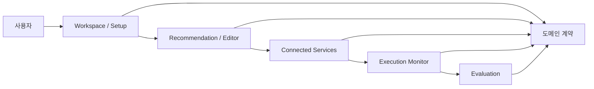
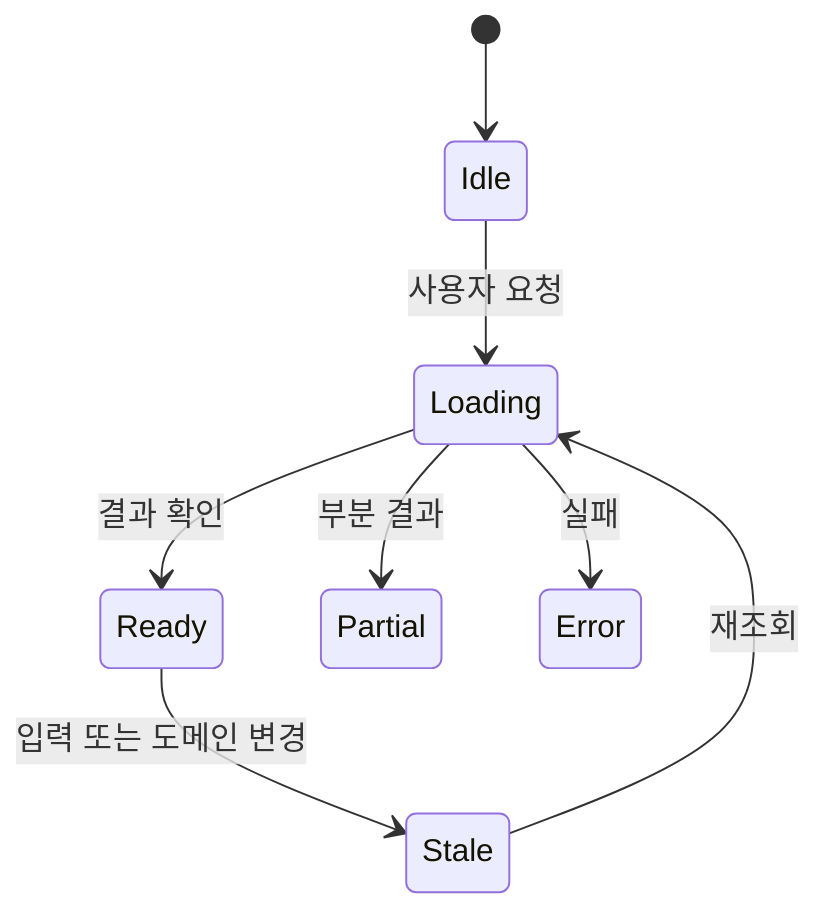

# ARC-01 GUI & UX Architecture

상태: 설계 초안 · 기준: 대화로 제공된 ARC-00 v0.1. Flutter Desktop은 1차 설계 방향이며 상세 화면과 플랫폼 지원은 검증 전이다.

## 목적과 범위
사용자가 프로젝트를 연결하고 목표·제약을 입력하여 추천을 검토·수정하고 실행·관측·평가하는 흐름을 제공한다. 화면의 픽셀 설계는 범위 밖이다.

## 책임 및 비책임
Presentation은 사용자 입력, 화면 상태, 접근성 및 도메인 결과 표시를 담당한다. 인증정보 처리, Provider 구현, 정책 집행과 비즈니스 정본은 소유하지 않는다. UI의 승인 표시는 ARC-09의 실제 승인 기록과 집행 검증을 대체하지 않는다.

## 기능 및 비기능 요구사항
- Workspace Dashboard, 목표·제약, 추천, Canvas·Editor, 연결 서비스, 실행 모니터, 평가의 정보 구조를 제공한다.
- 추천 근거·대안·불확실성, Provider 기능의 supported/unsupported/unknown, 외부 전송 및 변경 계획을 구분해 보여준다.
- 적용과 위험 행위는 대상·범위·영향을 표시하고 명시적 승인받는다. 취소 요청과 실제 종료를 구분한다.
- 키보드 접근과 스크린리더를 고려하며 시각적 상태 외의 표시를 제공한다. 접근성 목표·표시 빈도는 P3·P4로 확정([설계 확정 기록](DESIGN_FINALIZATION.md)), 실제 검증은 제품게이트다.

## 내부 컴포넌트

## 공개 인터페이스
| 사용자 동작 | 도메인 호출 | 표시 결과 |
|---|---|---|
| 분석 범위 확인 | ARC-02 previewScope/analyze | 제외 항목·부분 결과 |
| 추천 검토 및 편집 | ARC-03 propose/validate, ARC-04 validate | 근거·대안·미지원 기능 |
| 설정 적용 | ARC-04 planExport/apply, ARC-09 승인 | diff·충돌·적용 결과 |
| 연결 및 실행 | ARC-05 상태, ARC-06 prepare/start | 공식 로그인 경로·실행 상태 |
| 취소·평가 | ARC-06 cancel/observe, ARC-09 평가 | 취소 요청과 종료·판정 불가 구분 |

호출 결과의 버전·시각을 표시하고 오래된 데이터는 새로고침을 유도한다. UI 재시도는 동일 요청 ID를 사용하여 중복 실행을 방지한다.

## 데이터 모델 및 상태 전이
화면은 선택된 workspace, 화면별 입력 초안, 비동기 요청 상태, 도메인 객체의 ID·버전과 표시 오류를 소유한다. 정본 상태는 ARC-10이다.

## 실행 시나리오 및 장애 복구
프로젝트 선택 후 범위·제약을 확인하고 추천과 대안을 검토한다. 사용자가 구성과 적용 diff를 승인한 후 인증 상태 및 실행 준비를 확인한다. 실행 모니터에서 이벤트·중단·실패·Unknown을 구분한다. 연결 장애나 재시작 시 로컬 정본을 재조회하고 이전 UI 상태를 실행 성공으로 취급하지 않는다.

## 보안 및 권한
비밀정보 입력·표시를 요구하지 않고 공식 인증 경로로 연결한다. 외부 전송, 파일 변경과 도구 실행의 승인 대상을 분리한다. 오류 화면과 진단에 민감정보가 노출되지 않도록 한다. UI 잠금만을 보안 경계로 간주하지 않는다.

## 테스트 전략 및 Definition of Done
키보드·스크린리더, unknown 기능, 부분 분석, stale diff, 승인 취소, 중복 클릭, 재시작과 취소 경합을 시험한다. ARC-02~10 계약 및 접근성 검토와 사용자 승인이 문서 완료 조건이다. 플랫폼별 실제 접근성 검증은 구현 단계에서 수행한다.

## 관련 ADR 및 의존 관계
ARC-00 ADR-001, 002, 005, 009, 010과 관련한다. ARC-02~10의 공개 계약과 상태·승인 정보를 소비한다.

## 미결정 사항
화면 세부 디자인, 접근성 기준·지원 OS, 코어 IPC, 실행 이벤트의 표시 빈도, 사용자 설정과 언어 지원 범위.

설계 확정(Final, 2026-11-17): P3·P4·P5·P6으로 확정. 코어 IPC·지원 OS는 W-block·P1·P2를 따름. 정본은 [설계 확정 기록 §6](DESIGN_FINALIZATION.md).

## 템플릿 시스템 영향 · 상위 설계
ARC-15의 Gallery·상세 미리보기·캔버스·속성 패널·저장 및 가져오기/내보내기·검증 결과를 표시한다. 템플릿 원본과 프로젝트 편집본의 차이 및 미지원 Capability를 구분한다. 클라이언트별 편집 범위와 접근성은 ARC-11~13과 후속 검토한다.
