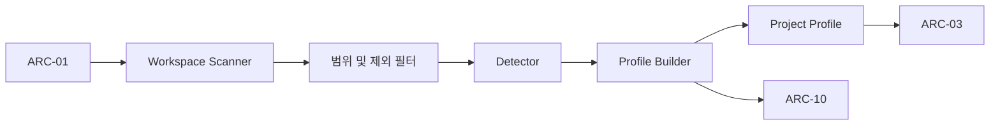
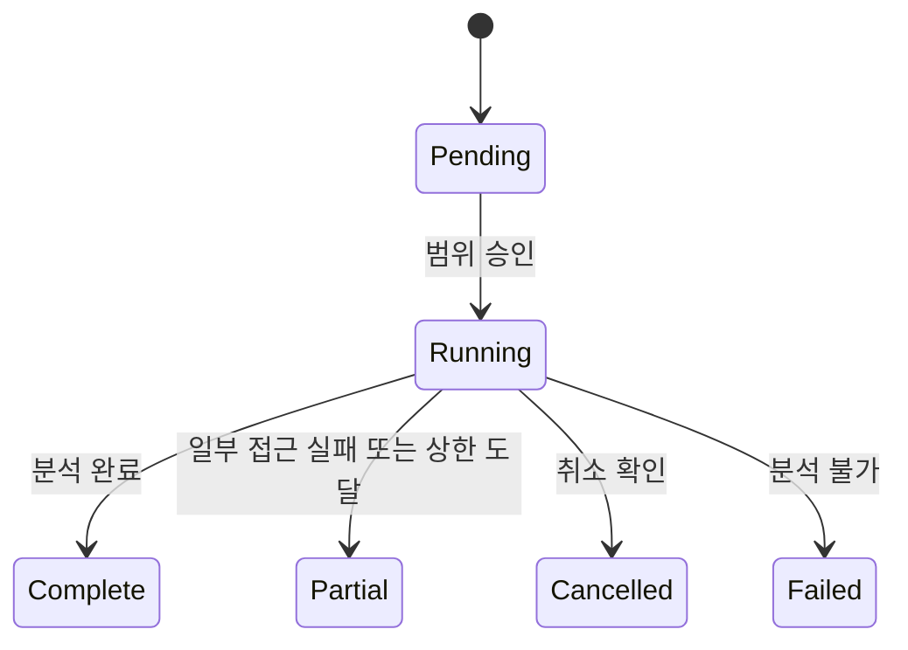

# ARC-02 Project Analyzer

상태: 설계 초안 · 기준: 대화로 제공된 ARC-00 v0.1. 사용자 프로젝트를 읽기 전 권한과 수집 범위를 확인한다.

## 목적과 범위
연결된 로컬 프로젝트와 사용자가 입력한 목표·제약을 분석하여 근거와 불확실성을 포함한 Project Profile을 만든다.

## 책임 및 비책임
Workspace Scanner는 허용 경로의 메타데이터와 파일을 읽고, Detector는 프로젝트 특징을 추론하며, Profile Builder는 관찰과 추론을 구분한다. 분석 결과를 바탕으로 아키텍처를 선택하는 일은 ARC-03, 파일 수정은 승인된 ARC-04 적용 작업의 책임이다. 분석기는 프로젝트 코드를 실행하지 않는다.

## 기능 및 비기능 요구사항
- 사용자에게 탐색 루트와 제외 규칙을 표시하고 민감 파일·무관한 대용량 파일을 제외한다. 제외 목록과 탐지 실패를 Profile에 명시한다.
- 메타데이터, 탐지된 언어·구조, 목표·제약 및 관찰 출처를 구분한다. 근거 없는 특징은 unknown으로 표시한다.
- 로컬 분석과 모델 Provider로 전송되는 내용 및 범위를 구분해 사용자가 검토한다. 프로젝트 파일은 수정하지 않는다.
- 심볼릭 링크·경로 이탈을 차단하고, 파일 수·크기·시간 상한을 둔다. 구체 상한은 N2로 확정([설계 확정 기록](DESIGN_FINALIZATION.md)).

## 내부 컴포넌트

## 공개 인터페이스
| 연산 | 입력 | 결과 |
|---|---|---|
| previewScope | 루트, 제외 규칙 | 대상 요약, 제외·접근 불가 항목 |
| analyze | 승인된 범위, 목표·제약, requestId | 분석 ID 및 Project Profile 또는 부분 실패 |
| getProfile | 분석 ID | 버전, 관찰·추론·근거·불확실성 |
| cancel | 분석 ID | 취소 요청과 최종 중단 상태 |

모델 전송이 필요한 선택적 분석은 전송 내용에 대한 별도 사용자 승인 후 진행한다. 결과는 원본 파일 내용 전체가 아니라 필요한 근거 참조를 우선한다.

## 데이터 모델 및 상태 전이
Profile은 workspaceRef, 분석 버전·시각, 관찰, 추론, 근거, 제외·오류와 사용자 입력 제약을 포함하는 논리 모델이다. 파일은 분석 시점 이후 변경될 수 있으며 결과에 시점을 표시한다.

## 실행 시나리오 및 장애 복구
범위 미리보기 후 사용자가 승인하면 분석하고, 일부 파일 접근 실패는 Partial과 근거로 남긴다. 중간 취소 시 불완전한 결과를 완전한 Profile로 제시하지 않는다. 프로젝트 변경 시 재분석이 필요함을 알리고 이전 결과는 시점과 함께 구분한다. 권한 오류와 파일 사라짐은 전체 실패와 구별한다.

## 보안 및 권한
비밀파일 제외 규칙은 완전한 탐지를 보장하지 않는다. 내용 전송 전 사용자 확인과 최소화가 필요하며, 민감정보를 로그에 넣지 않는다. 신뢰할 수 없는 파일은 데이터로만 취급하고 내부 지시를 실행 지침으로 승격하지 않는다. 격리와 읽기 권한 범위는 OS별 확인이 필요하다.

## 테스트 전략 및 Definition of Done
대형 트리, 접근 거부, 심볼릭 링크 탈출, 파일 변경 경합, 비밀 파일, 악성 지시 텍스트, 취소 및 외부 전송 승인 부재를 시험한다. ARC-03의 Profile 소비와 ARC-10 보관 경계를 검토하고, 부분 결과 표시 및 테스트 수용 기준을 기록하며 사용자 승인을 받으면 문서 완료다.

## 관련 ADR 및 의존 관계
ARC-00 ADR-001, 008, 009와 관련한다. ARC-01의 사용자 범위 승인, ARC-03의 Profile 소비, ARC-09 정책, ARC-10 기록에 의존한다.

## 미결정 사항
파일 제외 기본값과 예외, 분석 범위 상한, Profile 상세 스키마, 사용자 검토 방식, 외부 전송 정책 및 파일 변경 감지 방식.

설계 확정(Final, 2026-11-17): N1~N7로 확정. 정본은 [설계 확정 기록 §6](DESIGN_FINALIZATION.md).
