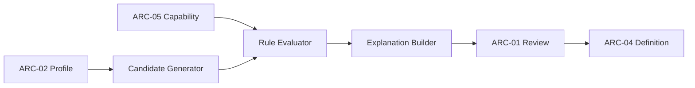
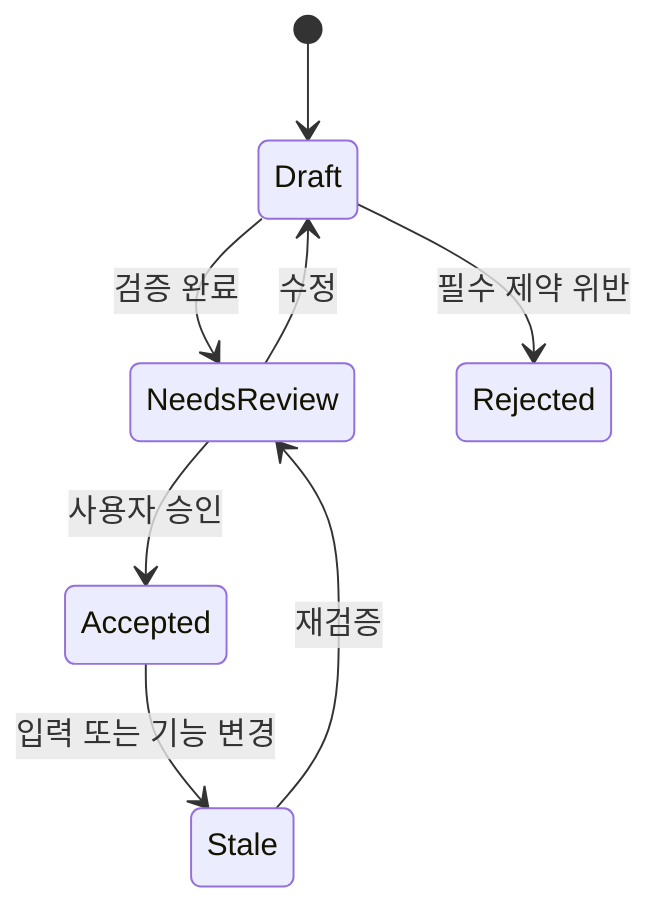

# ARC-03 Architecture Decision Engine

상태: 설계 초안 · 기준: 대화로 제공된 ARC-00 v0.1. 추천은 검증 가능한 제안이며 Provider 지원 보장이 아니다.

## 목적과 범위
Project Profile, 목표·제약과 검증된 Capability를 기반으로 단순한 구조부터 평가하고 근거·대안·불확실성을 가진 Architecture Proposal을 생성한다.

## 책임 및 비책임
Rule Evaluator는 명시적 제약을 검사하고 Candidate Generator는 패턴 후보를 만들며 Explanation Builder는 선택 이유와 더 단순한 대안을 제시한다. 실제 실행과 설정 적용은 ARC-04/06, 평가 판정과 승인 집행은 ARC-09 소관이다. 모델의 서술을 검증된 사실로 취급하지 않는다.

## 기능 및 비기능 요구사항
- Single Agent를 기준선으로 검토하며 chaining, routing, parallelization, orchestrator-workers, evaluator-optimizer 등은 필요성과 제약을 설명한다.
- 각 제안에 근거, 더 단순한 대안, 비용·지연·정확성 가정, 실패 사례와 미확인 사항을 담는다.
- Capability가 unknown인 기능은 지원된다고 가정하지 않는다. 필수 기능이 확인되지 않으면 실행 가능 확정을 차단한다.
- 입력 Profile 버전과 규칙·생성 조건을 추적하고 LLM 추천과 결정적 검사를 분리한다. 품질과 지연 목표는 평가 데이터 확보 후 결정한다.

## 내부 컴포넌트

## 공개 인터페이스
| 연산 | 입력 | 결과 |
|---|---|---|
| propose | Profile 버전, 제약, Capability 스냅샷 | 후보, 근거, 대안 및 불확실성 또는 생성 실패 |
| validateProposal | 제안 버전과 최신 제약·Capability | 충족·위반·확인 필요 목록 |
| accept | 사용자 승인된 제안 버전 | 승인 참조; 변경 시 재검토 필요 |

생성 모델의 출력은 신뢰하지 않고 구조·제약을 검증한다. 승인 결과는 실제 실행 승인을 대체하지 않는다.

## 데이터 모델 및 상태 전이
Proposal은 후보 구성, 근거 출처, 가정, 대안, Profile·Capability 버전, 검증 결과와 승인 참조를 포함한다.

## 실행 시나리오 및 장애 복구
단일 구조부터 후보를 만들고 규칙으로 불가능한 후보를 배제한 다음 가정과 대안을 표시한다. 사용자 수정 후 재검증하며 Profile 또는 Provider 버전이 바뀌면 승인을 무효화하지 않고 stale로 표시해 재검토한다. 생성 실패 시 기존 승인 제안을 변경하지 않고 오류와 재시도 방안을 제시한다.

## 보안 및 권한
프로젝트 텍스트를 명령으로 신뢰하지 않고 외부 전송은 사용자 승인과 최소화 정책을 따른다. 추천은 도구 권한 부여 또는 실행을 허용하지 않는다. 비밀정보와 민감 원문은 설명·로그에 넣지 않는다.

## 테스트 전략 및 Definition of Done
단순 작업의 기준선, 명시적 제약 위반, unknown capability, 모순된 모델 출력, stale 입력, 생성 실패와 악성 프로젝트 지시를 시험한다. 설계 검증용 데이터셋 구성·기준선·합격 조건은 REQUIREMENTS_ACCEPTANCE를 따르며 운영 성능 합격치는 미정이다. ARC-02/04/05/09 계약 정합성 및 사용자 승인이 문서 완료 조건이다.

## 관련 ADR 및 의존 관계
ARC-00 ADR-004, 010, 012를 따른다. ARC-02 Profile과 ARC-05 Capability를 입력으로 사용하고 ARC-04 구성 및 ARC-09 평가와 교차 검토한다.

## 미결정 사항
후보 생성 방식, 규칙 언어, 근거의 세부 구조, 평가 fixture 검토와 운영 지표·합격치, 모델 사용 및 비용 추정 방법.

설계 확정(Final, 2026-11-17): E1·E2·E6 확정, 운영 수치 임계치는 E5 조건부. 정본은 [설계 확정 기록 §6](DESIGN_FINALIZATION.md).

## 템플릿 시스템 영향 · 상위 설계
ARC-15 Registry에서 후보와 버전·요구 Capability를 조회하고 ARC-02의 Profile을 바탕으로 이유와 더 단순한 대안을 제시한다. 사용자 선택 후 변경안은 제안으로만 다루며 ARC-15의 유효성·호환성 검사와 사용자 승인, ARC-09 정책을 대체하지 않는다.
