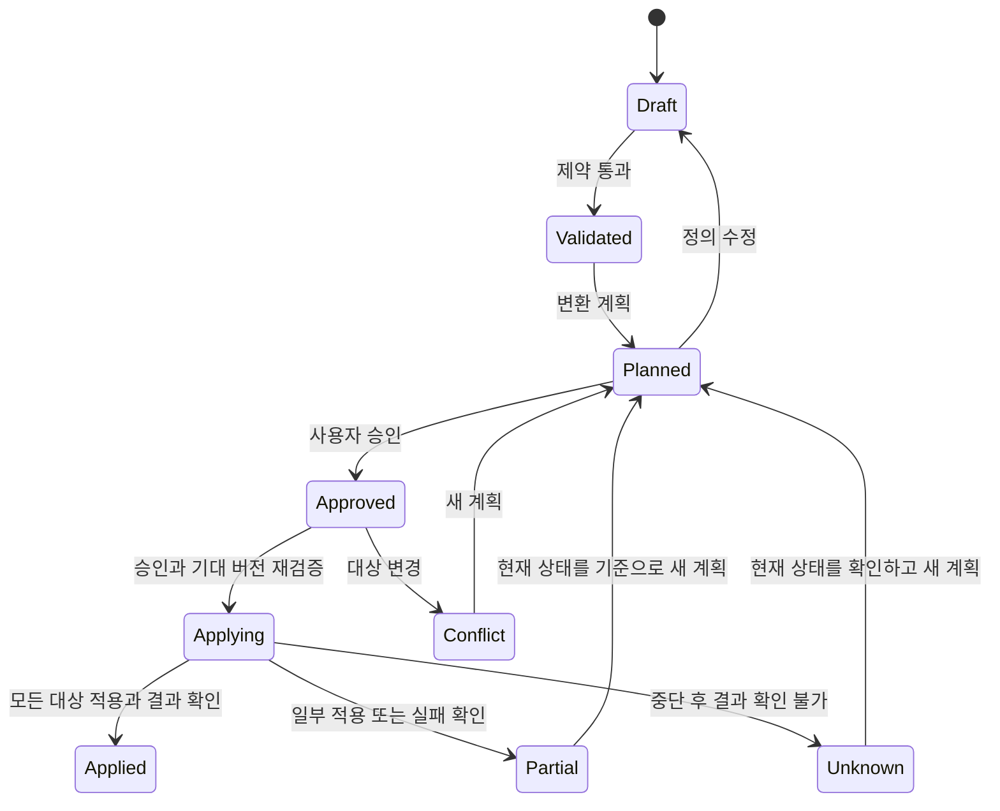

# ARC-04 Agent Definition & Configuration

상태: 설계 초안 · 기준: 대화로 제공된 ARC-00 v0.1 및 ARC-03/05/06.

## 목적과 범위
승인된 구조를 Provider 중립 에이전트 정의로 표현하고, 지원되는 Provider 설정으로 변환할 적용 계획과 차이를 사용자에게 제시한다.

## 책임 및 비책임
Definition Editor는 역할·도구·권한·입출력 원칙을 관리하고 Validator는 제약을 확인한다. Export Planner는 Adapter를 통해 적용 계획을 만들고 승인된 변경만 적용한다. 실제 프로세스 실행은 ARC-06, 인증은 ARC-05, 추천은 ARC-03이다. 공식 형식 및 지원은 Provider별 검증 전 미확정이다.

## 기능 및 비기능 요구사항
- 중립 정의는 모델, Runtime, 계정 참조 및 권한을 구분하고 특정 Provider의 미지원 기능을 표시한다.
- 내보내기 전 변경 대상·내용·충돌·손실 가능성을 보여주고 명시적인 적용 승인을 받는다.
- 기존 파일의 동시 변경 여부를 재확인하며 기대 버전이 다르면 중단한다. 자동 덮어쓰기를 하지 않는다.
- 도구 권한을 정의했다고 실제 집행된다고 가정하지 않는다. 비밀정보를 설정이나 진단에 포함하지 않는다.

## 내부 컴포넌트

## 공개 인터페이스
| 연산 | 입력 | 결과 |
|---|---|---|
| validate | 정의와 Capability 버전 | 오류·지원 여부·손실 경고 |
| planExport | 정의, 대상 경로와 현재 파일 버전 | 변경 계획·diff·충돌·기능 손실 |
| apply | 승인된 계획 ID, 기대 파일 버전, 요청 ID | 적용 완료·충돌·부분 적용·결과 불명과 대상별 결과 |
| exportPreview | 정의와 Adapter | 파일 내용 미리보기, 적용 없음 |

승인은 계획 내용과 대상 및 버전에 묶인다. 파일이나 계획이 바뀌면 재승인이 필요하다. 다중 파일 변경의 원자성은 검증 전 보장하지 않으며 부분 적용과 복구 결과를 표시한다.

## 데이터 모델 및 상태 전이
AgentDefinition은 버전, 역할, 입출력·도구·권한, 모델 및 Runtime 참조를 논리적으로 포함한다. ExportPlan은 대상 파일 버전, 변경 내용, Adapter 버전 및 손실 경고를 갖는다.

## 실행 시나리오 및 장애 복구
제안을 편집·검증하고 미리보기와 diff를 확인한 후 사용자가 적용한다. 적용 직전 대상 경로와 버전을 재검증한다. 권한 오류나 부분 쓰기가 발생하면 대상별 적용 여부와 확인 불가 항목을 기록하고 Partial 또는 Unknown으로 표시한다. 모든 대상의 적용과 결과가 확인될 때만 Applied로 표시한다. 재시작 후 현재 파일과 계획 당시 버전을 비교하며 복구나 재적용은 새 계획과 사용자 승인 후 진행한다. 자동으로 기존 파일을 삭제하지 않는다.

## 보안 및 권한
경로 이탈과 심볼릭 링크를 검증하고 대상 이외의 파일은 변경하지 않는다. 사용자 승인과 도구 자체의 실제 실행 권한은 별도이며 ARC-09와 확인한다. 자격증명은 ARC-05 공식 저장 경계에 남긴다.

## 테스트 전략 및 Definition of Done
지원 불가 기능, 손실 변환, stale 승인, 파일 변경 경합, 경로 탈출, 부분 적용, 취소 및 비밀 노출을 시험한다. Adapter별 공식 형식과 실제 동작 검증, ARC-03/05/06/09 정합성 검토 및 사용자 승인이 문서 완료 조건이다.

## 관련 ADR 및 의존 관계
ARC-00 ADR-004, 005, 009, 012와 관련한다. ARC-03 승인 제안, ARC-05 Capability, ARC-06 실행과 ARC-09 승인, ARC-10 산출물 기록에 의존한다.

## 미결정 사항
아래 v0.2에서 중립 정의와 버전·손실 처리의 논리 계약을 제안한다. 실제 직렬화 스키마와 수치 상한, Provider별 형식·의미 등가성, 다중 파일 적용의 원자성 및 복구, 실제 적용 경로와 사용자 승인은 미결정이다.

설계 확정(Final, 2026-11-17): S1·S2·S3·S4·S11 확정. Provider별 등가성 실증은 제품게이트. 정본은 [설계 확정 기록 §6](DESIGN_FINALIZATION.md).

## 템플릿 시스템 영향 · 상위 설계
Agent Definition과 Provider별 설정 변환은 이 모듈에 남는다. ARC-15는 버전별 Template Definition과 프로젝트 Instance를 관리하며 Runtime Binding은 인스턴스별 환경 참조로 구분한다. 템플릿 복제나 내보내기는 인증정보를 포함하거나 설정 적용 승인을 대체하지 않는다.

## 보완 계약 v0.2: 중립 정의와 Provider 변환

다음은 최초 교환 모델 제안으로 운영 스키마 승인이나 특정 CLI 지원을 뜻하지 않는다. `AgentDefinition` v1의 필수 필드는 `schemaVersion`(major/minor), `definitionId`, `revision`, `role`(비어 있지 않은 문자열), `instructions`(신뢰되지 않은 작업 지시와 구분된 사용자 작성 지침), `inputs`/`outputs`(각각 유일한 `portId`, `type`, `required`), `tools`(유일한 capabilityId 목록), `permissions`(행위·대상 범위·승인 필요), `resourceLimits`(시간·시도 상한)다. Account·credential 값과 실제 실행 경로는 definition에 포함하지 않으며 인스턴스별 Runtime Binding에서 참조한다. 문자열 길이·포트 및 항목 수는 파서의 설정된 상한을 넘어서는 입력을 거부하고, 실제 수치는 S3으로 확정([설계 확정 기록](DESIGN_FINALIZATION.md))하며, 보안 시험은 제품게이트다.

포트의 v1 타입은 `text`, `json`, `artifactRef`와 `control`이다. 같은 타입만 직접 연결하며 변환은 명시적이고 검증 가능한 노드가 지원될 때만 허용한다. `control`은 실행 순서이고 데이터 포트와 연결할 수 없다. 입력이 required이면 지원하는 한 개의 호환 출처 또는 명시적 사용자 입력을 요구한다. JSON의 세부 타입은 아직 표현하지 않으므로 호환 여부를 단정하지 않고 확인 필요로 표시한다. 알 수 없는 타입·필수 의미·major 버전은 `UNSUPPORTED_SCHEMA`로 실행을 막는다. 동일 major에서 지원하지 않는 minor 및 선택 필드는 보존 가능한 경우에만 편집 없이 보기/내보내기를 허용하며 알 수 없는 의미를 제거한 채 적용하지 않는다. 편집·적용에는 지원하는 전체 의미가 필요하다.

ARC-15의 Agent 노드는 정확한 `definitionId`/`revision`을 참조하거나 독립 복사된 v1 정의를 포함한다. Instance의 revision은 변경 시 증가하고 templateVersion은 불변이다. 정의·인스턴스·capability snapshot 중 하나가 변경되면 이전 검증 보고서와 적용 계획은 stale이다. 일치하지 않거나 참조 누락 시 `INVALID_REFERENCE`, 타입 불일치 시 `PORT_MISMATCH`, 필수 기능 unknown 시 `CAPABILITY_UNKNOWN`을 반환하며 실행·적용하지 않는다.

Adapter는 `plan(definitionRevision, targetProviderVersion, capabilitySnapshotId)`에서 각 원본 필드에 대해 `EXACT`, `LOSSY`, `UNSUPPORTED`, `UNKNOWN`과 대상 필드·근거·영향을 담은 MappingReport를 반환한다. `EXACT`는 버전 고정된 공식 형식과 실험 증거가 있는 경우에만 허용한다. 필수 권한·범위·안전 속성의 LOSSY/UNSUPPORTED/UNKNOWN은 적용과 실행을 차단한다. 선택적 표현 손실은 사용자에게 변경 diff와 사유를 보여 주고 원본·대상·버전에 묶인 별도 적용 승인을 받은 경우에만 허용하며 실행 승인을 대체하지 않는다. 저장된 정의 원본은 변환으로 변경하지 않는다. Provider 업데이트 또는 capability 변경 시 계획은 stale로 재생성한다. 공식 Adapter 구현·형식 매핑과 각 Provider의 실제 의미 등가성은 모두 미검증이다.

검증은 지원하지 않는 major, 알 수 없는 필수 필드, 존재하지 않는 참조, 다른 포트 타입, 여러 출처와 단일 필수 입력, 필수 권한의 lossy 변환, 승인 후 대상 버전 변경 및 Provider 버전 변경에 대해 적용·실행 0건을 요구한다. 검증기에서 언급 없는 필드는 자동으로 exact로 추론하지 않는다.
