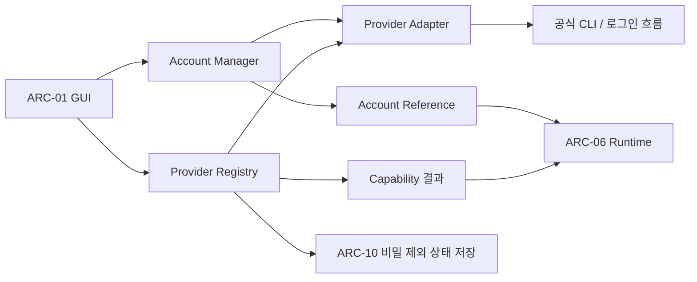
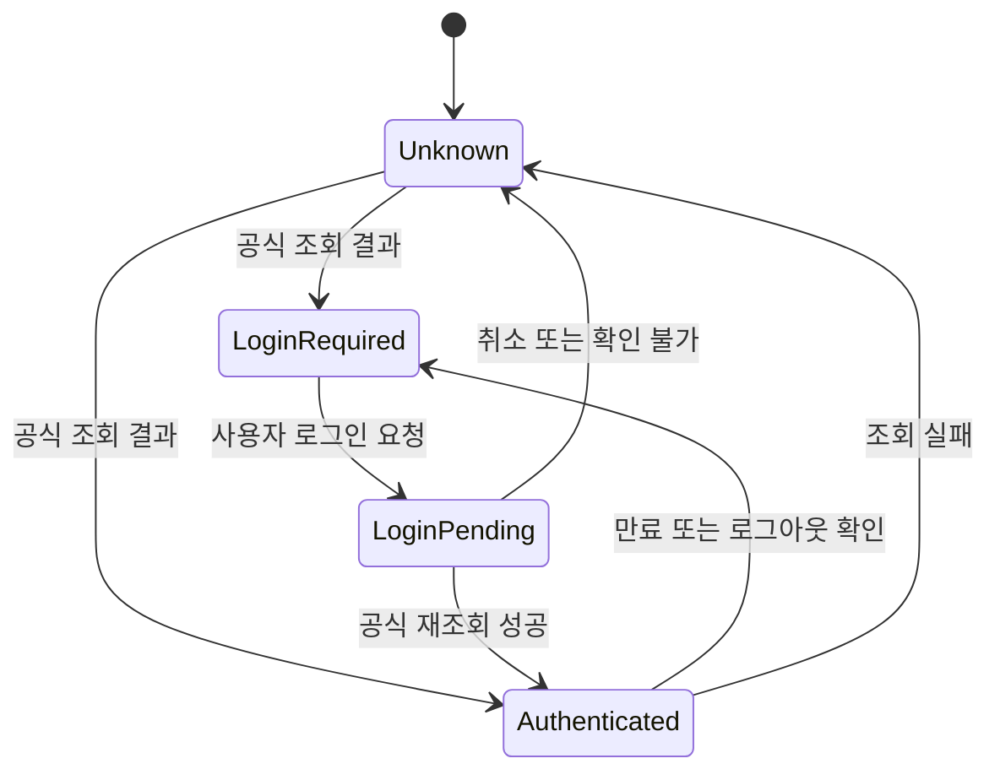

# ARC-05 Provider & Account Management

상태: 사용자 검토용 초안 · 2026-11-15 · 기준: 대화로 제공된 ARC-00 v0.1. 설계 제안이며 Provider별 연동 구현과 정책 검증을 완료했다는 의미가 아니다.

## 목적과 범위
설치된 실행 도구의 식별, 버전 및 기능 확인, 공식 로그인 진입, 인증 상태와 계정 참조의 안전한 관리 경계를 정의한다. 최초 MVP Provider와 OS는 미정이다.

## 책임과 비책임
Registry는 설치 후보를 탐지하고 출처·버전·신뢰도와 capability를 기록한다. Account Manager는 공식적으로 제공되는 로그인 진입과 상태 조회를 매개한다. Adapter는 Provider별 기능을 공통 계약으로 표현한다. 세션 프로세스와 수명주기는 ARC-06, 추천은 ARC-03, 정책 결정은 ARC-09가 담당한다. 인증 토큰 추출, 비공식 로그인 재사용 및 자체 자격증명 대리는 범위 밖이다.

## 요구사항
- 설치·버전·기능 상태를 사용자에게 제공하고 미확인, 미지원 및 실패를 구분한다.
- 공식 로그인 경로만 사용하며 인증 과정은 명시적 사용자 요청으로 시작한다. 계정 식별자는 공식 인터페이스가 제공하는 범위에서만 표시한다.
- 모델, Runtime, Account, Session을 별개 개념으로 관리한다. 실행 전 계정 참조와 capability를 ARC-06에 전달한다.
- 동시 계정 격리가 확인되지 않은 경우 해당 조합을 지원한다고 표시하거나 병렬 실행을 허용하지 않는다. 원인과 대안을 표시한다.
- 로컬 상태의 내구성과 조회 가능성을 고려하며 비밀정보를 일반 저장소·로그에 기록하지 않는다. 특정 성능 수치는 미정이다.

## 컴포넌트와 경계

## 공개 인터페이스: 논리 계약 제안
구체 언어·IPC·함수 시그니처는 미정이다. 모든 결과는 Provider, 조회 시각, 근거와 오류를 포함하며 조회 실패를 미지원으로 단정하지 않는다.

| 작업 | 입력 | 결과 및 실패 |
|---|---|---|
| discover | 사용자 승인된 탐색 범위 | 설치 후보·경로·버전 또는 접근/실행 오류 |
| capabilities | 설치 참조 | 기능별 supported / unsupported / unknown, 근거와 버전 |
| authStatus | 설치 및 선택된 계정 참조 | 상태 및 확인 근거; 공식 조회 불가 시 unknown |
| beginLogin | 설치 및 사용자 명시 요청 | 공식 흐름 시작 여부; 완료 여부는 재조회로 확인 |
| resolveAccount | 사용자 선택 | 불투명한 계정 참조 또는 사용 불가 사유; 토큰 제외 |

ARC-06은 시작 직전 참조와 기능을 재검증하고, 미지원·unknown 기능에 의존하는 실행은 차단하거나 사용자에게 해결 방법을 제시한다. ARC-03은 capability를 추천 제약으로만 사용한다. ARC-10에는 비밀이 아닌 참조·상태·변경 근거만 보관한다.

## 데이터 및 상태
ProviderInstallation은 식별자, 경로, 버전, 탐지 시각과 출처를 논리적으로 포함한다. CapabilitySnapshot은 설치·버전별 기능 상태와 확인 근거를 포함한다. AccountReference는 Provider에 한정된 불투명 참조이며 비밀 자체를 포함하지 않는다. 구체 필드와 보존기간은 미정이다.

## 주요 시나리오
1. 탐색 후 설치 후보 및 공식적으로 확인 가능한 기능을 표시한다. 경로·버전이 바뀌면 이전 capability를 재검증한다.
2. 사용자가 공식 로그인 시작을 요청하면 해당 흐름을 실행하고 완료 후 상태를 재조회한다. 상태를 확인할 수 없으면 unknown을 표시한다.
3. 사용자가 계정을 선택하면 실행 전 ARC-06이 설치·계정·capability 유효성을 확인한다. 격리 미검증이면 동시 실행을 차단한다.

## 오류 및 복구
설치 없음, 권한 부족, 로그인 취소, 상태 조회 불가, 버전 변경을 구분한다. 각 경우 재탐색, 공식 로그인 재시도 또는 수동 확인을 제시한다. 자동 반복은 상한을 두며 실패를 성공으로 기록하지 않는다. 앱 재시작 후 공식 상태를 재조회하고 이전 캐시는 근거 시각과 함께 표시한다.

## 보안 및 권한
사용자 승인 없는 인증 변경과 토큰·쿠키 추출은 금지한다. 실행 파일 탐색 및 실행 경로의 신뢰 검증 방식은 OS별 검증 대상이다. 명령 인자와 환경변수, 오류 메시지에 자격증명이 포함되지 않도록 설계·시험한다. Worktree는 샌드박스가 아니며 실제 격리 보장은 ARC-06/09에서 검증한다.

## 테스트 전략 및 Definition of Done
가짜 Adapter로 미설치, 버전 변경, unknown, 로그인 취소, 인증 만료, 조회 실패, 동시 계정 격리 미확인 상황을 시험한다. 실제 공식 CLI별 시험은 OS·버전·계정 조건과 정책 근거를 기록하고 사용자 승인 하에 수행한다. 로그와 저장 데이터에서 비밀정보가 노출되지 않는지 검사한다. 완료는 계약 및 실패 상태에 대한 교차 검토, 각 테스트 기준과 미결 사항 기록, 사용자 승인으로 판정한다. 실제 Provider 지원 선언은 별도 검증을 통과해야 한다.

## 관련 ADR 및 의존성
ARC-00 ADR-004 중립 스키마와 Adapter, ADR-005 공식 인증, ADR-011 복구 가능성, ADR-012 capability를 따른다. 모두 설계 방향이며 Provider 검증이 남아 있다. 별도 ADR이 필요한 새 확정 결정은 없다. ARC-06과 실행 및 계정 참조 계약, ARC-10과 저장, ARC-09와 권한 경계를 후속 교차 검토한다.

## 미결정 및 근거
OS·최초 Provider·계정 식별 가능성·격리 방식·공식 GUI 연동 허용·capability 상세·로그인 취소 후 상태 확인·계정 삭제 정책은 미정이다. [Claude Code 인증](https://code.claude.com/docs/en/authentication), [Codex 인증](https://learn.chatgpt.com/docs/auth), [Antigravity 인증](https://antigravity.google/docs/install?tab=cli)은 공식 설명이지만 본 제품과의 연동 권한이나 격리 보장을 뜻하지 않는다. Antigravity 문서의 로컬 표면 간 인증 공유 설명은 계정 격리 검증의 필요성을 더한다. 실제 최신 문서, 약관, 사용 환경과 제공 버전별 기능은 실험 전 확인해야 한다.

설계 확정(Final, 2026-11-17): 최초 범위 P12(Mock/Claude 1차/Codex 2차), 격리 R11, 비용 상태 E3. 공식 연동 허용·격리·삭제 정책 실증은 제품게이트. 정본은 [설계 확정 기록 §6](DESIGN_FINALIZATION.md).
