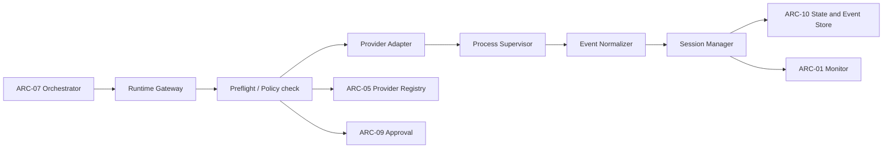
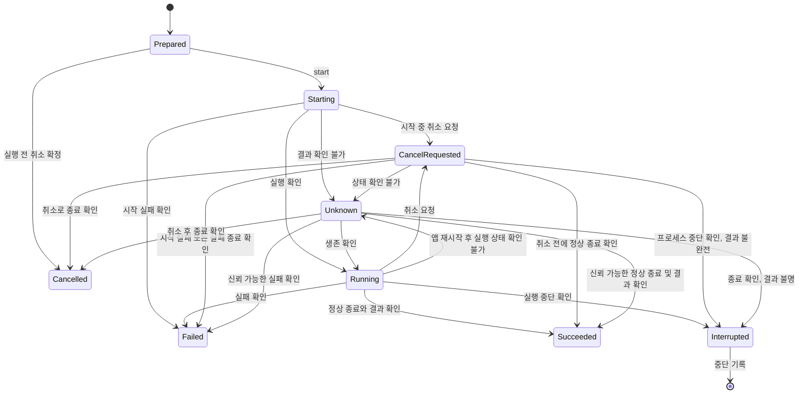
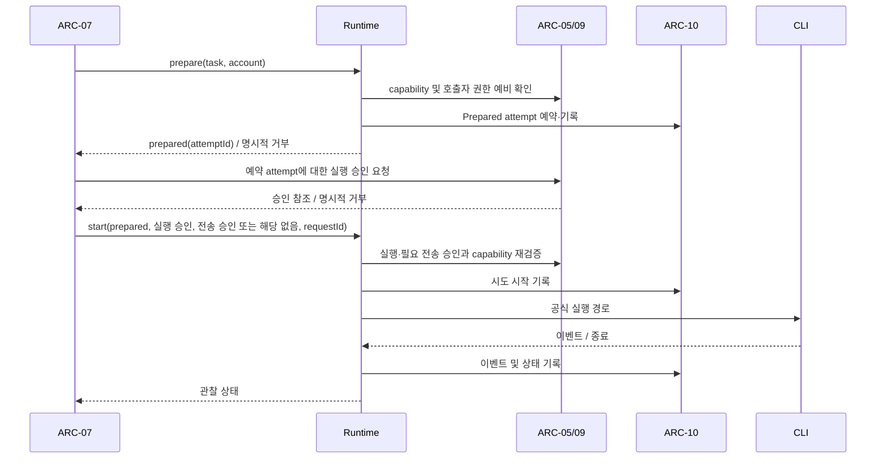

# ARC-06 Runtime & Session Management

상태: 설계 초안 · 2026-11-15 · 기준: 대화로 제공된 ARC-00 v0.1, ARC-05. 공식 Provider 지원을 검증한 결과가 아니다.

## 목적과 범위
승인된 작업을 공식 지원 범위의 실행 도구에서 시작하고, 세션 이벤트와 결과를 추적하며 취소·중단·복구를 관리한다. 모델과 도구, 계정, 세션, 작업 및 실행 시도는 별개다.

## 책임 및 비책임
Runtime Gateway는 실행 계약을 제공하고 Process Supervisor는 자식 프로세스 수명주기를 관측한다. Session Manager는 시도별 상태와 식별자를 관리한다. Adapter는 공식 CLI의 기능을 변환한다. ARC-05는 설치·인증·계정, ARC-07은 작업 의존성과 재시도 정책, ARC-09는 승인 정책, ARC-10은 영속 기록을 소유한다. Runtime은 추천 결정이나 비공식 자격증명 추출을 하지 않는다.

## 기능 및 비기능 요구사항
- 실행 전에 설치·인증·계정 참조와 필수 Capability, 승인 범위, 작업 디렉터리와 제약을 검증한다. 불명확한 필수 기능은 실패로 처리한다.
- 실행 시도별 고유 ID를 만들고 시작·이벤트·종료 결과를 기록한다. 동일 요청 ID는 동일한 논리적 시작 요청으로 기록한다. 외부 프로세스 생성 경계의 장애 시 정확히 한 번 실행은 보장하지 않는다.
- 취소 요청, 실제 종료, 사용자 중단, 비정상 실패와 복구 불가를 구별한다. 성공은 종료 근거와 결과 확인 이후에만 기록한다.
- 이벤트가 지연·누락되거나 앱이 종료되어도 관찰된 사실과 불확실성을 보존한다. 비밀정보는 로그에 남기지 않는다. 성능 수치는 MVP 환경 측정 후 결정한다.
- 외부 Provider 전송이 수반되는 입력과 로컬 저장을 구분하고 사용자가 검토할 수 있게 한다.

## 내부 컴포넌트

## 공개 인터페이스
논리 계약이며 실제 IPC·시그니처는 미정이다. prepare는 workspaceId·taskId와 호출자 권한을 포함하고 실행 승인 없이 부작용 없는 예비 검사 후 Prepared attemptId를 예약·저장한다. start는 준비 참조, 해당 attempt에 결부된 실행 승인 및 requestId를 포함한다. attemptId는 예약 시 발급하며 cancel 등 기존 시도 변경에도 포함한다.

| 연산 | 입력과 조건 | 출력 및 실패 |
|---|---|---|
| prepare | 적용 또는 선택이 완료된 구성, 설치·계정 참조, Capability, 인증된 호출자 권한; 실행 승인은 아직 불필요 | 예약·저장된 Prepared attemptId와 실행 요청 digest 또는 부족한 권한·지원·인증 사유; 외부 프로세스·Provider 전송 없음 |
| start | 유효한 Prepared 참조, 해당 attempt에 결부된 실행 승인, 외부 전송이 수반되면 별도 전송 승인 참조·입력 digest, requestId | 예약된 attemptId와 상태; 중복 요청은 기존 결과 또는 충돌 반환 |
| observe | attemptId 및 커서 | 순서·출처가 있는 이벤트 페이지와 누락 여부; 커서의 보존기간은 ARC-10에서 결정 |
| cancel | attemptId, requestId | 취소 요청 수락; 종료 확인을 의미하지 않음 |
| inspect | attemptId | 마지막 확인 상태·시각 및 불확실성 |
| resume | 기존 시도 및 지원 근거 | 새 실행 시도 또는 명시적 미지원; 자동 재실행 금지 |

승인·Capability는 실행 직전 다시 확인한다. 시작 중 취소가 접수되면 새 프로세스를 생성하기 전에 취소를 확인한다. 생성과 취소가 경합한 경우 시작 성공 또는 실패를 관측할 때까지 CancelRequested를 유지하고, 프로세스가 생겼다면 종료를 요청한다. 외부 실행 여부를 확인할 수 없으면 Unknown으로 전환한다. 파일 경로와 명령 구성은 쉘 문자열 결합을 피하는 방식으로 Adapter가 다루며, 실행 가능 파일의 신뢰 검증 방법은 OS별로 검증한다.

## 데이터 및 상태 전이
ExecutionAttempt는 attemptId, taskId, installationRef, accountRef, 승인 참조, 생성·관측 시각, 상태, 종료 근거와 이벤트 커서를 논리적으로 갖는다. 개인 데이터 및 보존 기간은 ARC-10에서 확정한다. 이벤트는 원본과 정규화 결과를 구분하며 원본에 비밀이 있으면 저장 정책에 따라 보호·제외한다.

`Interrupted`는 실행 중단이 확인됐으나 결과는 불완전한 종료 상태다. 앱 종료만으로 외부 CLI가 중단됐다고 판단하지 않는다. 종료 상태(Succeeded, Failed, Cancelled, Interrupted)는 동일 시도에서 되돌리지 않는다. `Unknown`은 성공·실패가 아니며 무조건 재실행하지 않는다. 작업의 최종 성공은 ARC-07/09의 검증과 별개다.

## 시나리오

## 오류 처리 및 복구
시작 기록과 외부 프로세스 생성은 원자적이지 않다. 시작 기록 후 프로세스 생성 전 또는 생성 직후 앱이 중단되면 재시작 시 결과를 Unknown으로 두고 자동 재실행하지 않는다. requestId 중복 방지는 이 경계에서 정확히 한 번 실행을 보장하지 않는다. 저장 실패 시 새 실행을 시작하지 않는다. 실행 중 저장이 실패하면 감독을 유지하고 사용자에게 경고하며 추가 작업 시작을 중지한다. 앱이 재시작되면 마지막 상태와 공식 수단으로 관찰한 프로세스 상태를 비교한다. 프로세스 식별자 재사용 가능성을 고려해 단일 PID만으로 동일성을 확정하지 않는다. 확인할 수 없으면 Unknown으로 두고 사용자 판단을 요청한다. 재개는 Provider capability와 명시적 사용자/정책 승인이 있는 경우에만 새 시도로 연결하며, 실제 지원 여부는 검증 대상이다.

## 보안 및 권한
승인은 대상·행위·범위·유효 기간에 결부하고 변경 시 재검증한다. GUI가 승인 표시만 한다고 실행을 강제 통제할 수 있다고 가정하지 않는다. CLI의 권한 제어 및 OS 격리는 실제 환경에서 검증해야 한다. Worktree는 보안 샌드박스가 아니다. 로그에는 인증정보와 민감 인자를 기록하지 않으며 ARC-10의 접근·보존 정책을 적용한다.

## 테스트 전략 및 Definition of Done
가짜 Adapter 및 통제된 프로세스로 중복 시작, 시작 중 충돌, 취소와 종료 경합, 이벤트 순서·유실, 저장 실패, 앱 재시작, PID 재사용, 복구 불가, 인증 만료와 승인 만료를 시험한다. 공식 도구별 검증은 OS·버전·계정·약관과 근거를 기록하고 별도로 수행한다. 완료 조건은 상태별 허용 전이와 계약 예외의 검토, ARC-05/07/09/10 정합성 확인, 테스트 가능 수용 기준 기록 및 사용자 승인이다. 실행 기능 검증 완료를 의미하지 않는다.

## 관련 ADR과 의존 관계
ARC-00 ADR-004, 005, 007, 009, 011, 012를 따른다. ARC-05의 capability와 계정 참조, ARC-07의 작업, ARC-09의 정책, ARC-10의 상태 저장이 필요하다. 구체 저장소와 IPC는 확정하지 않는다.

## 미결정 사항
최초 OS/CLI, 정확한 이벤트 스키마와 순서 보장, 취소·재개 공식 지원, 중단 후 프로세스 탐지, 장기 실행 상한, 원본 로그 민감정보 처리, 승인 강제 및 샌드박스 구현은 미확정이다.

설계 확정(Final, 2026-11-17): 최초 OS/CLI는 P1·P12, 스키마·상한·탐지·로그는 R1·R2·R7·R8, 강제·샌드박스는 R9(미지원 명시). 공식 지원 실증은 제품게이트. 정본은 [설계 확정 기록 §6](DESIGN_FINALIZATION.md).

관련 신규 제안: [ADR-013 외부 실행의 불확실성 보존](adr/ADR-013-runtime-observation.md).

## 후속 승인·시도 식별 계약 v0.3

`prepare`는 외부 프로세스를 만들지 않는다. 모든 실제 실행의 attemptId는 실행 승인 요청 및 start 전에 예약·저장하며 `Prepared` 시도의 정본으로 사용한다. ARC-09 실행 승인은 그 run·task/revision·예약 attemptId·실제 요청 digest·환경 snapshot에 결부한다. `start`는 같은 예약·requestId·유효한 실행 승인을 검증한다. CLI 시작이 Provider 전송을 유발하면 수신자·입력 digest·목적·범위가 일치하는 별도 전송 승인도 시작 직전 검증한다. 전송 여부·범위 또는 집행이 unknown이거나 승인이 없으면 차단한다. 검증과 시작 의도 기록 후에만 자식 프로세스를 만든다. 사전 예약은 실제 실행·성공 또는 외부 부작용을 의미하지 않는다. 저장·예약·승인 실패는 시작 차단, 재시도는 새 attempt와 새 승인이다. 정확한 트랜잭션과 Provider 지원은 별도 시험 전 미검증이다. 상세 승인별 null과 범위는 [ARC-09](ARC-09.md)의 보완 계약 v0.3을 따른다.
