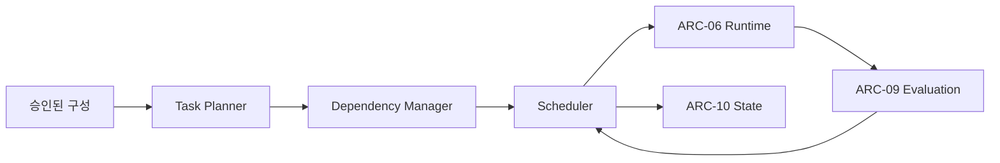
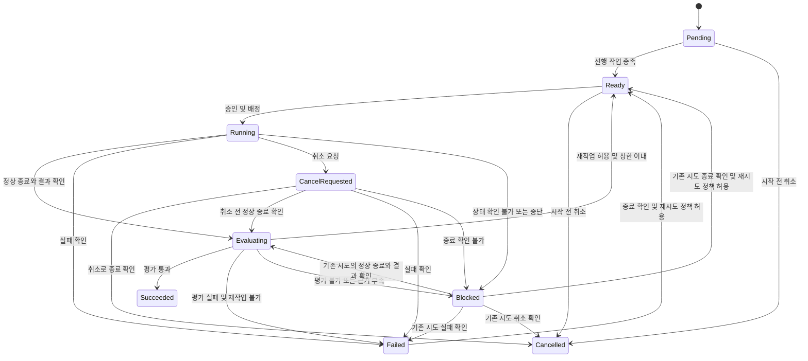

# ARC-07 Orchestration & Task Scheduling

상태: 설계 초안 · 기준: 대화로 제공된 ARC-00 v0.1 및 ARC-06/10.

## 목적과 범위
승인된 구성과 목표를 작업 및 의존성 그래프로 표현하고, 허용된 병렬성과 상한 내에서 작업을 배정·관측·검증한다.

## 책임 및 비책임
Task Planner는 DAG를 제안하고 Dependency Manager는 순환과 선행 조건을 검사한다. Scheduler는 준비된 작업을 배정하고 Review Controller는 평가 결과와 재작업 조건을 반영한다. 실제 프로세스·인증은 ARC-06/05, 권한 결정은 ARC-09가 담당한다. Task와 ExecutionAttempt는 별도이며 미확인 실행을 재실행하지 않는다.

## 기능 및 비기능 요구사항
- DAG의 순환, 누락된 의존성 및 자원 충돌을 검사하고 독립적인 작업만 병렬 실행한다.
- 재시도 횟수·비용 또는 실행 시간 상한을 적용한다. 구체 기본값은 미정이다.
- 모든 배정과 상태 전이를 ARC-10에 기록하고 승인되지 않은 작업은 시작하지 않는다.
- 작업 중단, 실패, 취소 및 미확인 시도를 구분하며 작업 성공은 ARC-09 검증을 거친다.

## 내부 컴포넌트

## 공개 인터페이스
| 연산 | 입력 | 결과 |
|---|---|---|
| plan | 목표, 승인 구성, 제약 | DAG 제안과 근거·충돌 |
| validateGraph | DAG 버전 | 순환·누락·권한·상한 검사 결과 |
| startRun | 승인 DAG, 제한, requestId | 실행 ID 또는 거부 사유 |
| requestCancel | 실행 또는 작업 ID | 취소 요청; 완료 확인은 별도 |
| inspectRun | 실행 ID | 작업 상태·시도·차단 사유 |

실행 시작 시 DAG와 승인의 버전을 확인한다. 동일 requestId는 하나의 논리적 실행 요청에 대응하도록 ARC-10의 낙관적 동시성 제어를 사용한다. 외부 프로세스의 정확히 한 번 실행은 보장하지 않으며 불확실하면 Blocked로 둔다.

## 데이터 모델 및 상태 전이
Task는 ID, 의존성, 상태, 승인·제약과 시도 목록을 갖는다. Run은 DAG 버전, 제한 및 작업 상태를 참조한다. 실행 시도 자체는 ARC-06이 소유한다.

## Runtime 상태와 작업 상태의 대응

| ARC-06 시도 상태 | ARC-07 작업 상태 | 처리 |
|---|---|---|
| Prepared / Starting / Running | Running | 배정된 시도를 추적한다. |
| CancelRequested | CancelRequested | 취소 수락만으로 종료 처리하지 않는다. |
| Succeeded | Evaluating | 실행 결과의 성공은 작업 평가 통과와 별개다. |
| Failed | Failed | 재작업은 정책과 상한 확인 후 새 attempt를 예약하고 그 attempt에 별도 실행 승인을 받은 뒤 시작한다. |
| Cancelled | Cancelled | 취소 확인 후 후속 작업은 차단한다. |
| CancelRequested → Interrupted | Blocked | 중단은 확인됐지만 결과가 불완전해 취소 성공으로 단정하지 않는다. |
| Interrupted | Blocked | 종료는 확인됐으나 결과가 불완전하다. 재작업은 명시적 판단이 필요하다. |
| Unknown | Blocked | 기존 실행 여부를 확인할 때까지 자동 재시작하지 않는다. |

정책상 실패 재시도가 허용되는 경우 Failed에서 Ready로 전환할 수 있으며, Ready 전환은 이전 시도 종료 확인과 재시도 정책·상한을 전제로 한다. 새 실행 전에 ARC-06이 새 attempt를 예약하고 ARC-09가 그 attempt에 대한 새 실행 승인을 발급해야 한다. 평가가 실패해도 재작업이 허용되면 Evaluating에서 Ready로 이동한다. 이때 새 시도 ID를 발급한다.

## 실행 시나리오 및 장애 복구
승인된 DAG에서 준비된 작업을 선택하고 Runtime에 시작 요청을 보낸다. 결과를 평가한 뒤 후속 작업을 해제한다. 프로세스 종료와 평가 실패를 구분하며 재시도는 상한과 승인에 따른다. 재시작 시 ARC-10 상태와 ARC-06 관찰을 대조하고 불확실한 시도는 Blocked로 남긴다. 취소 경합에서는 확인된 Runtime 결과를 우선 기록한다. Blocked에서 Ready로 전환하려면 기존 시도가 더 이상 실행되지 않음이 확인되어야 하며, 확인할 수 없으면 중복 실행 위험을 해소하기 전까지 차단한다.

## 보안 및 권한
의존성에 의해 권한이 암묵적으로 전파되지 않는다. 각 작업의 권한과 외부 전송 범위는 ARC-09의 승인에 묶는다. 병렬 작업의 파일 충돌과 세션 격리 가능성을 검증하고 Worktree를 샌드박스로 취급하지 않는다.

## 테스트 전략 및 Definition of Done
순환·누락 의존성, 병렬 충돌, 중복 배정, 취소 경합, 저장 장애, 앱 재시작, unknown 실행, 재시도 상한과 평가 실패를 시험한다. ARC-06/09/10 계약 및 사용자 승인 후 문서를 완료 처리한다.

## 관련 ADR 및 의존 관계
ARC-00 ADR-007, 008, 009, 011과 관련한다. ARC-04 구성, ARC-06 시도 및 이벤트, ARC-09 승인·평가, ARC-10 정본 상태에 의존한다.

## 미결정 사항
스케줄링 알고리즘·공정성, 자원 제한과 기본 상한, 선점 가능 범위, 다중 Provider 동시 계정 격리, DAG 편집과 복구 세부 계약.

관련 신규 제안: [ADR-013 외부 실행의 불확실성 보존](adr/ADR-013-runtime-observation.md).

## 템플릿 시스템 영향 · 상위 설계
ARC-15의 검증된 프로젝트 Instance를 입력으로 받고 작업 DAG·배정·상한과 실행 상태는 ARC-07이 관리한다. 템플릿 연결 구조의 검사는 실행 가능성이나 권한 승인을 의미하지 않는다. 조건과 제한된 반복·서브그래프의 실행 표현은 후속 설계에서 검증하며 무제한 반복과 순환 참조를 허용하지 않는다.

## 후속 평가·병렬 실행 정합 계약 v0.3

ARC-09가 평가한 정확한 불변 artifact manifest·기준·시도에 대한 유효한 PASS를 ARC-10의 Task 성공 전이와 같은 로컬 트랜잭션에서 확인한다. 그 성공은 평가된 snapshot에 한정하며 가변 workspace 파일의 현재 버전을 자동으로 증명하지 않는다. 비교·보존·접근 확인이 불가능하면 최신 상태는 UNKNOWN 또는 Blocked로 둔다. 사용자 파일과 DB는 원자적이지 않으며 평가/전이 사이 변경 경합 시험 X20은 [교차 계약 수용 사례](CONTRACT_ACCEPTANCE_MATRIX.md)를 따른다. 결과가 다르거나 재시도하면 해당 결과·시도에 대해 새 평가와 새 실행 승인이 필요하다.

같은 자원의 쓰기 충돌이 있는 작업은 실제 충돌 해소, 검증된 직렬화 또는 안전한 격리 전에는 병렬로 시작하지 않는다. 사용자의 일반 확인은 실제 격리를 대체하지 않는다. 격리 여부가 불명이면 해당 병렬 배정을 차단한다.
