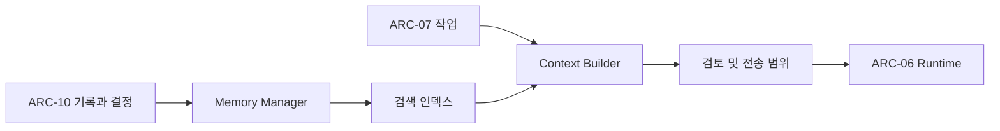
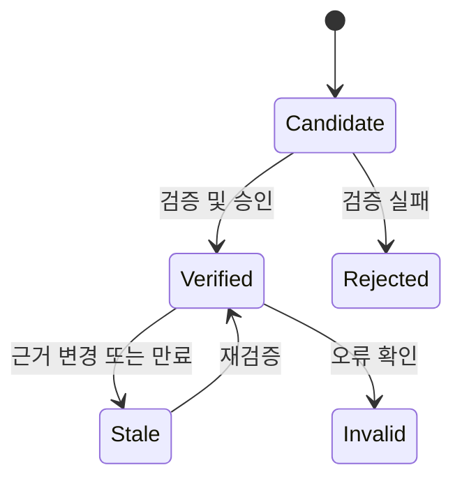

# ARC-08 Memory & Context Management

상태: 설계 초안 · 기준: 대화로 제공된 ARC-00 v0.1 및 ARC-10.

## 목적과 범위
원본 기록을 근거로 검증된 결정과 재사용 가능한 지식을 관리하고, 현재 작업에 필요한 컨텍스트만 선택한다. Dreaming은 후속 확장으로 설계하며 자동 확정이나 원본 삭제를 기본 동작으로 삼지 않는다.

## 책임 및 비책임
Memory Manager는 지식의 출처·유효 상태를 관리하고 Context Builder는 작업과 제약에 맞는 자료를 선택한다. Indexer는 검색용 파생 인덱스를 만든다. 정본 저장과 접근 제어 수단은 ARC-10, 검증·승인 규칙은 ARC-09, 작업 상태는 ARC-07이 담당한다. 요약은 원본이나 작업 상태 정본을 대체하지 않는다.

## 기능 및 비기능 요구사항
- 원본·검증된 결정·장기 기억·검색 인덱스를 구분하고 지식에서 근거와 검증 상태를 추적한다.
- 작업에 필요한 정보만 선택하며, 사용자에게 선택 근거와 외부 Provider 전송 범위를 검토할 수 있게 한다.
- 오래되거나 모순되는 지식은 유효성을 알 수 없음으로 표시한다. 인덱스 손실 시 근거 기록으로 재구성할 수 있도록 한다.
- 검색·저장 시 민감정보와 접근 범위를 고려한다. 검색 지연과 컨텍스트 크기의 구체 수치는 E8로 확정([설계 확정 기록](DESIGN_FINALIZATION.md)).

## 내부 컴포넌트

## 공개 인터페이스
| 연산 | 입력 | 결과 |
|---|---|---|
| proposeMemory | 근거 참조와 후보 내용 | 검토 대기 후보 및 출처 |
| validateMemory | 후보와 검증 결과 | 유효·무효·확인 필요 |
| selectContext | 작업, 권한, 크기 제약 | 선택 항목·출처·제외 이유 및 전송 미리보기 |
| invalidate | 지식 ID와 사유 | 유효 상태 변경 및 인덱스 갱신 요청 |

선택 결과는 승인이나 외부 전송을 자체 수행하지 않는다. 접근 불가 또는 출처가 사라진 지식은 확인 필요로 표시한다.

## 데이터 모델 및 상태 전이
MemoryEntry는 ID, 내용 참조, 근거, 생성·검증 시각, 유효성 및 접근 범위를 논리적으로 포함한다. ContextSelection은 작업·선택 항목·이유·제약과 버전을 기록한다.

## 실행 시나리오 및 장애 복구
작업 컨텍스트 요청 시 현재 권한과 유효 상태를 확인하고 필요한 자료를 선택해 사용자에게 전송 범위를 제시한다. 인덱스가 손상되면 원본·승인된 지식에서 재구성하며 출처가 없는 결과는 유효하다고 단정하지 않는다. Dreaming 제안은 근거와 변경 내용을 유지하고 승인된 정책 없이 원본을 삭제하거나 결정을 확정하지 않는다.

## 보안 및 권한
최소 권한과 전송 최소화를 적용하고 민감정보를 인덱스·로그에 무조건 복제하지 않는다. 외부 문서의 지시는 데이터로 취급한다. 접근 범위가 달라지면 기존 선택 결과를 재검증한다.

## 테스트 전략 및 Definition of Done
근거 삭제·변경, 모순 지식, 접근 취소, 인덱스 손상, 민감정보, 컨텍스트 크기 초과, 악성 지시 및 전송 승인 부재를 시험한다. ARC-07/09/10의 계약 검토와 사용자 승인이 문서 완료 조건이다.

## 관련 ADR 및 의존 관계
ARC-00 ADR-008, 009와 관련한다. ARC-07 작업, ARC-09 검증·권한, ARC-10 기록과 인덱스 저장에 의존하며 ARC-06에 선택 결과를 제공한다.

## 미결정 사항
Knowledge Wiki와 Memory Notes 형식·권한, 검색 방식, 유효기간, 전송 승인 세부 흐름, Dreaming의 실행·검증 정책과 정량 성능 목표.

설계 확정(Final, 2026-11-17): E7·E8·E9로 확정. 전송 승인 흐름은 T3·E10을 따름. 정본은 [설계 확정 기록 §6](DESIGN_FINALIZATION.md).
