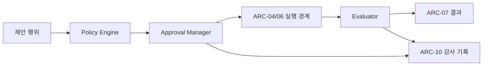
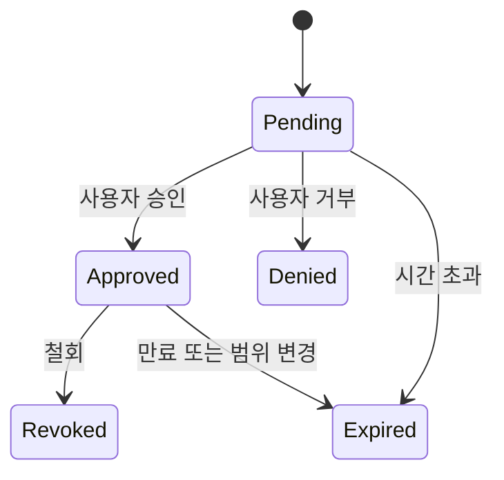

# ARC-09 Evaluation & Safety

상태: 설계 초안 · 기준: 대화로 제공된 ARC-00 v0.1. 보안 강제와 평가 성능은 별도 실험 전 보장하지 않는다.

## 목적과 범위
에이전트 실행 결과를 기준선과 비교하고, 위험 행위에 대한 정책·권한·사용자 승인 경계를 정의한다. 평가와 안전은 모든 계층에 적용된다.

## 책임 및 비책임
Policy Engine은 제안 행위의 허용·거부·승인 필요 여부를 판정하고 Approval Manager는 사용자 결정을 기록한다. Evaluator는 기준·근거에 따라 결과를 평가한다. 실제 집행은 ARC-04/06과 OS·Provider 경계에서 검증해야 한다. 평가 점수는 자동으로 권한을 부여하지 않는다.

## 기능 및 비기능 요구사항
- 승인 요청은 행위·대상·범위·유효기간과 제안 버전에 결부하며, 변경 또는 만료 시 재평가한다.
- 검증되지 않은 집행 경계에서는 위험 행위를 차단하고 사용자에게 한계를 명시한다. 경고나 사용자 승인만으로 차단을 해제하지 않는다.
- 단일 에이전트 기준선과 후보를 같은 작업·조건에서 비교하고 성공률, 시간, 비용 또는 사용량은 실제 사용 가능한 범위로 기록한다.
- 평가 근거, 환경·버전·반복 횟수 및 미측정 항목을 보존한다. 설계 검증용 데이터셋 구성과 합격 조건은 REQUIREMENTS_ACCEPTANCE를 따르며 운영 품질 목표는 미정이다.

## 내부 컴포넌트

## 공개 인터페이스
| 연산 | 입력 | 결과 |
|---|---|---|
| evaluatePolicy | 주체·행위·대상·범위·상황 | allow / deny / approval_required / unknown 및 근거 |
| requestApproval | 구체적 행위와 유효기간 | 승인 요청 ID 또는 거부 |
| verifyApproval | 요청 ID와 실제 행위·현재 시각 | 유효·불일치·만료·철회 |
| evaluateResult | 결과·평가 기준·환경 | 통과·실패·판정 불가 및 근거 |

unknown은 허용으로 처리하지 않는다. 승인된 범위의 집행이 가능한지는 별도로 확인해야 한다.

### 승인 검증 경계

승인 요청은 주체, 작업·시도, 행위 종류, 정규화된 대상, 허용 범위, 입력 또는 적용 계획의 버전, 발급·만료 시각을 논리적으로 식별한다. ARC-04는 적용 직전 파일과 계획을 재확인하고 ARC-06은 시작 직전 실행 조건을 재확인한다. 실제 경로 해석이나 파일 변경이 확인 이후 바뀌는 경합은 재검증만으로 완전히 막을 수 없다. 구현에서는 OS가 제공하는 안전한 접근 수단을 선정해 검증해야 하며, 강제할 수 없는 범위는 사용자에게 알리고 해당 위험 행위를 차단한다. 실행 도중 권한 철회가 가능한지와 이미 실행 중인 CLI의 행위를 중단할 수 있는지는 Provider별 미확정이다.

## 데이터 모델 및 상태 전이
Approval은 ID, 행위·대상·범위·버전·결정 주체·시각·만료와 결정을 갖는다. Evaluation은 기준·환경·결과·측정값과 출처를 갖는다.

## 실행 시나리오 및 장애 복구
실행 전 실제 행위에 대해 정책을 평가하고 필요 시 승인받는다. ARC-06은 시작 직전 승인을 재검증한다. 평가기가 실패하거나 근거가 부족하면 판정 불가로 기록하며 성공을 추정하지 않는다. 승인 저장 실패 또는 집행 불가 시 위험 작업을 시작하지 않는다.

## 보안 및 권한
외부 Provider 전송, 로컬 파일 변경 및 명령 실행을 구분한다. 사용자 승인 UI만으로 CLI 내부 모든 행위가 통제된다고 가정하지 않는다. OS 샌드박스와 Provider별 권한 강제를 별도로 검증하며 Worktree는 충돌 완화 수단이다. 승인·평가 기록에 비밀정보를 포함하지 않는다.

## 테스트 전략 및 Definition of Done
승인 만료·철회·범위 변경, 우회 시도, 집행 미지원, 평가기 실패, 데이터 누락, 비용 미제공, 재현 가능한 회귀 평가를 시험한다. 자동 평가와 사람 검토의 차이를 기록한다. ARC-04/06/07/10 경계 검토 및 사용자 승인이 문서 완료 조건이다.

## 관련 ADR 및 의존 관계
ARC-00 ADR-009, 010, 012와 관련한다. ARC-03 추천 평가, ARC-04 변경 승인, ARC-06 집행, ARC-07 재작업, ARC-10 감사 기록에 의존한다.

## 미결정 사항
위험 분류·승인 유효기간, 실제 Provider 및 OS의 집행 능력, 설계 검증용 평가 집합의 실제 fixture·검토, 운영 품질 합격치, 비용 자료의 공식 가용성.

## 참고 근거
[Anthropic 에이전트 평가](https://www.anthropic.com/research/demystifying-evals-for-ai-agents), 2026-01-09 발표, 2026-11-16 확인: 평가와 회귀 측정의 필요성을 설명한다. 본 문서의 승인 모델과 지표는 제품 설계 제안이다.

## 보완 계약 v0.2: 평가 대상의 고정과 재현

`evaluateResult`는 `workspaceId, runId, taskId, attemptId, taskRevision, artifactManifestId, criteriaId/version, evaluatorId/version, environmentDigest, operationId`를 입력으로 받는다. ARC-07은 taskRevision과 attemptId를, ARC-10은 ArtifactManifest 및 평가 기록의 정본을, ARC-09는 평가 의미와 verdict를 소유한다. manifest는 승인된 경로의 산출물별 ID, 버전 또는 콘텐츠 해시, 바이트 길이, 수집 시각과 접근 상태를 포함한다. 해시·버전 불일치, 파일 변경 중 읽기, 접근 불가 또는 불완전 수집은 `INDETERMINATE`이며 성공을 반환하지 않는다. 해시는 무결성 식별자이지 악성 여부나 출처의 진실성을 증명하지 않는다.

EvaluationRecord는 위 식별자, 평가 입력의 digest, 측정값·단위·미측정 사유, verdict(`PASS`, `FAIL`, `INDETERMINATE`), 근거 참조, 시각 및 평가기 버전을 포함한다. 평가 중 결과가 바뀌면 새 manifest와 평가가 필요하다. ARC-07은 같은 taskRevision·attemptId·manifest에 대해 유효한 `PASS`가 저장된 경우에만 Task를 Succeeded로 전이한다. 정책 또는 평가 기준이 바뀌면 해당 결과는 stale이며 재평가한다. 사용자 수동 판정은 판정자·사유·대상 버전을 기록하며 자동 측정과 구분한다. 저장 실패, 버전 충돌, 기준 미존재는 성공이 아니다. 요청 중복은 ARC-10 operationId 규칙에 따른다.

검증: 평가 후 가변 workspace 산출물 수정, 대상 누락, 해시 불일치, 다른 시도의 PASS 재사용, 기준 버전 변경, 평가 저장 실패를 각각 주입한다. 과거 불변 snapshot에 대한 유효한 성공은 유지하되 바뀐 현재 산출물에 이전 PASS를 적용하지 않으며 비교할 수 없으면 UNKNOWN/Blocked로 표시한다. 실측 데이터셋과 운영 합격치는 별도 확정하며 [요구사항·수용 기준](REQUIREMENTS_ACCEPTANCE.md)의 최초 설계 기준은 제품 성능을 증명하지 않는다.

검증되지 않은 집행 경계에서 경고를 표시한 후에도 실행 요청은 거부해야 한다. 이 조건은 V-09 및 V-13에서 각각 시험한다.

## 보완 계약 v0.3: 승인 종류별 바인딩

다음은 구현·사용자 승인 전 제안이며 `ApprovalRef`의 실제 생성·검증 소유자는 ARC-09다. 모든 종류는 `approvalId`, 결정 주체, 행위, 정규화된 대상, 허용 범위, 대상 workspace, 발급·만료 시각, 정책 버전, 결정 및 철회 상태를 필요로 한다. digest는 충돌 저항성이 있는 알고리즘 식별자·버전과 함께 정책이 정한 정규화된 정확한 바이트를 식별한다. 서로 다른 인코딩, 누락 필드, 해시/정규화 버전 미확인 시 일치로 간주하지 않는다. 알고리즘·정규화 포맷은 합의 전 실행 차단이다. 해시와 ID는 권한이나 사용자 신뢰 자체의 증거가 아니다.

| 승인 종류 | 추가 필수 바인딩 | 해당하지 않아 null을 허용하는 항목 | 검증·재사용 |
|---|---|---|---|
| 구성 적용 | `planId`, 계획 digest, 대상 파일과 기대 파일 version, AgentDefinition revision, Adapter version | 아직 작업/시도가 없으면 taskId/attemptId | 계획·파일·Adapter 변경은 승인 무효; 추가 파일에 확장 불가 |
| 실행 | runId, taskId/revision, 사전 예약된 attemptId, instance/DAG revision, binding, workspace, 정책·Capability snapshot, 허용 행위/대상과 실행 요청 digest | 위 필수 실행 항목에 null 불허 | 승인 직전 예약된 attempt만 가능. 다른 시도·재시도에는 새 attemptId와 새 승인이 필요. 이미 시작한 프로세스의 강제 취소 가능성은 별도 검증 |
| 외부 전송 | 대상 Provider/계정 참조·수신 범위, ContextSelection revision과 입력 digest, 전송 목적·데이터 범위 | 작업 이전의 전송인 경우에만 taskId/attemptId null 가능 | 입력·수신자·목적·정책이 달라지면 재승인. 실행 승인이나 템플릿 선택은 전송 승인을 대체하지 않음 |
| 템플릿 가져오기 확인 | candidateId, 원본/정규화 digest, 검증기·정책 버전, 대상 family 및 기대 revision | taskId/attemptId null | ARC-15 candidate의 소유·만료·해시·revision을 게시 직전 재검증. 실행 승인 아님 |

실행 attemptId는 실행 또는 프로세스 생성을 뜻하지 않는 사전 예약 식별자다. ARC-06은 검증된 task와 결부해 이 ID를 발급·저장한 뒤 이에 대한 사용자 승인을 요청한다. 저장 실패·예약 만료·승인 누락·불일치·철회 시 외부 프로세스를 만들지 않는다. start는 동일 예약 ID·실행 요청 digest 및 capability를 확인하고 `Starting`을 기록한 후에만 spawn한다. 같은 시도의 불확실성은 동일 ID로 추적하며 재시작하지 않는다. 새 시도는 새 ID와 새 실행 승인이며 이전 승인 또는 외부 전송 승인을 자동 상속하지 않는다. 세부 물리 메커니즘과 실제 Provider 집행은 미검증이다.

승인 검증 실패 예: null 필수 attemptId, 다른 작업·시도, revision/계획 digest 변경, 다른 수신 Provider, 발급/만료 역전, 승인 철회·저장 실패는 모두 차단한다. ARC-09 정책 결과와 신뢰 UI 자체도 위조 가능한 클라이언트 텍스트에서 유도하지 않는다. [교차 계약 수용 사례](CONTRACT_ACCEPTANCE_MATRIX.md) X07~X12 및 X23에서 구현 후 독립 검증해야 하며 현재 NOT RUN이다.

## 보완 계약 v0.3: 평가 대상의 불변 보존

ARC-10이 평가 대상 snapshot을 수집·무결성 확인하고 immutable manifest/blob 또는 동등한 버전 고정 저장 수단을 제공한다. ARC-09는 정확한 snapshot과 ARC-06 attempt, ARC-07 task revision, 평가 기준·평가기 버전을 결부해 판정한다. ARC-07은 해당 평가 PASS 참조가 같은 정본 트랜잭션에서 유효함을 검사한 뒤 그 snapshot에 한정된 Task 성공을 기록한다. 사용자 workspace의 가변 파일 변경과 로컬 DB는 원자적이지 않다. snapshot 수집 중 원본 변경을 배제하거나 탐지할 수 없으면 INDETERMINATE이며 실제 저장 방식은 ARC-10의 선택·시험 게이트에 따른다.

평가 이후 workspace 파일이 달라져도 **이미 고정한 과거 snapshot에 대한 성공 이력**은 보존한다. 다만 현재 파일의 버전이 그 snapshot과 같다고 증명할 수 없으면 현재 산출물의 최신 성공은 UNKNOWN이며 이전 PASS를 현재 파일에 적용하지 않는다. 불변 blob 손실·권한 철회·삭제 시 실제 접근을 거부하고 검증 가능성 또는 재현성을 unavailable로 표시한다. 감사 이력의 보존·삭제와 출처 제거는 ARC-10 정책에 따라 처리하며, 파일을 복원하거나 삭제된 내용을 UI에 노출하지 않는다.

X20의 수용 시험은 평가 완료와 Task 성공 전이 사이의 workspace 파일 변경·불변 blob 변조/소실·기준 변경을 각각 주입해, 기존 snapshot의 이력과 현재 파일의 상태를 구분하고 일치 여부를 확인할 수 없으면 INDETERMINATE/Blocked인지 독립 관측한다. 구현 시험은 NOT RUN이다.

## 클라이언트 인증과 승인 경계

플랫폼 식별 및 설치별 키 보유는 ARC-11의 인증 근거이며 실행 승인과 권한을 대신하지 않는다. 행위·workspace·revision·만료에 결부한 승인과 철회는 ARC-09가 소유한다. [설치별 인증 설계](CLIENT_INSTALLATION_AUTH_DESIGN.md)를 따른다.
