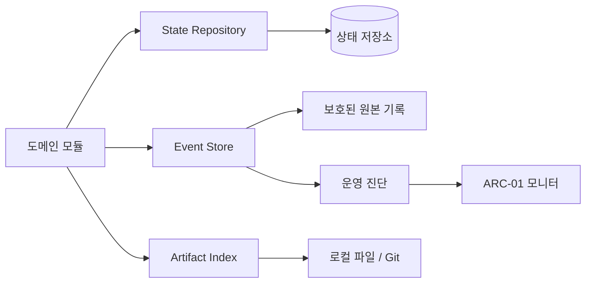
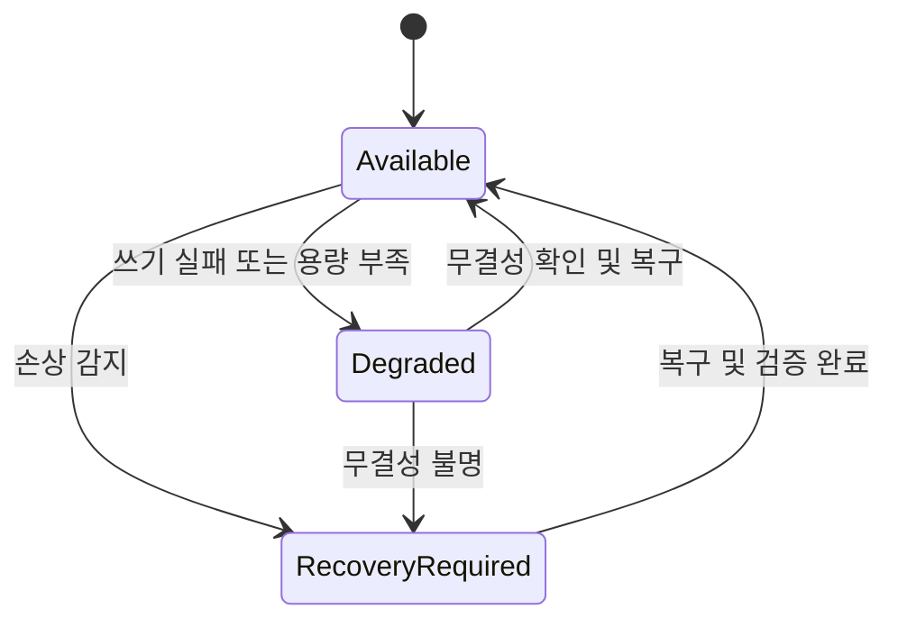

# ARC-10 Storage & Observability

상태: 설계 초안 · 기준: 대화로 제공된 ARC-00 v0.1, ARC-05/06. 물리 스키마·데이터 보존 기간과 구현 기술은 미확정이다. 설계 확정(Final, 2026-11-17): 저장 엔진 ADR-020·보존 기간 T1 확정. 물리 스키마 세부·DB 암호화·물리 소거는 제품게이트.

## 목적과 범위
작업 상태, 실행 원본, 승인된 결정, 산출물 및 검색용 기억을 구별해 로컬에 저장하고 운영 상태를 추적한다. SQLite는 작업 상태 저장소 후보이며 채택 완료가 아니다.

## 책임과 비책임
State Repository는 작업·시도·승인 상태의 정본, Event Store는 출처와 순서가 있는 실행 기록, Artifact Store는 로컬 산출물 참조, Diagnostics는 비밀을 제외한 운영 진단을 담당한다. 지식의 유효성 판단은 ARC-08, 실행 상태의 의미는 ARC-06/07, 접근 정책은 ARC-09가 소유한다. Git/Worktree는 버전 관리 수단이며 보안 샌드박스가 아니다.

## 기능 및 비기능 요구사항
- 상태 변경과 관련 이벤트를 일관되게 기록하며, 실패하면 호출자에게 명시한다. 실행 시작 기록이 실패하면 ARC-06은 실행하지 않는다.
- 원본 기록, 정규화 이벤트, 승인된 지식, 파생 인덱스를 구분하고 출처 관계를 유지한다. 메모리 요약은 작업 상태 정본이 아니다.
- 사용자 프로젝트 파일은 명시적인 적용 승인 없이 수정하지 않는다. 자격증명을 일반 데이터베이스, 진단 로그, 산출물에 저장하지 않는다.
- 저장 오류, 용량 부족, 충돌, 손상과 복구 불확실성을 표시한다. 성능·복구 목표치는 OS/CLI 선정 후 측정한다.
- 원본에도 민감정보가 있을 수 있다. 수집·표시·저장 전에 최소화와 보호 정책을 적용하며 원본이 항상 무수정 보관된다고 약속하지 않는다.

## 내부 컴포넌트

## 공개 인터페이스
모든 변경은 workspaceId, actor, operationId와 기대 버전을 포함한다. 실제 IPC와 필드 스키마는 미정이다.

| 계약 | 의미 | 실패 |
|---|---|---|
| readState(id) | 버전과 함께 현재 상태 조회 | 없음, 접근 거부, 손상 |
| commitTransition(id, expectedVersion, state, events, operationId) | 상태와 관련 이벤트를 원자적으로 기록; 동일 operationId 재호출은 기존 결과 반환 | 버전 충돌, 저장 실패, 중복 내용 불일치 |
| appendObservation(attemptId, sourceId, event) | 출처·관측 시각·중복 식별자를 포함한 관찰 기록 | 저장 실패; 누락 없는 전달은 보장하지 않음 |
| listEvents(attemptId, cursor) | 기록된 이벤트와 다음 커서, 유실·잘림 표시 | 만료·유효하지 않은 커서 |
| registerArtifact(reference, provenance) | 승인된 경로와 버전 참조 등록 | 범위 이탈, 접근 불가 |

상태 전이와 이벤트의 원자적 커밋은 제품의 설계 요구이며 SQLite 또는 다른 저장소에서 충족 가능한지 검증한다. 외부 CLI 실행과 로컬 트랜잭션은 하나의 원자적 작업이 아니다.

## 데이터 모델과 상태 전이
OperationalState는 버전·상태·소유 모듈을, EventRecord는 출처·관측 시각·순서 정보·보호 수준을, ArtifactReference는 경로·버전·출처·검증 상태를, KnowledgeReference는 원본 근거와 유효 상태를 갖는다. Credentials는 공식 CLI 또는 OS 보안 저장소에 남기며 일반 DB에 복제하지 않는다. 물리적 카디널리티는 미정이며 보존기간의 제안 기본값은 아래 v0.2를 따른다.

## 시나리오와 복구
정상 실행 시 ARC-06은 시도 시작을 커밋한 후 CLI를 시작하고 관찰 이벤트를 기록한다. 앱 중단 뒤에는 기록된 상태와 실제 관찰을 대조하며 불명확한 시도는 Unknown으로 둔다. 부분 쓰기, 디스크 가득 참, 권한 거부, 중복 이벤트, 손상된 인덱스는 원본을 무단 삭제하지 않고 새 실행을 막거나 진단한다. 인덱스는 근거 기록에서 재구성할 수 있도록 설계한다. 백업·마이그레이션·복구 방식은 실제 저장 기술 선정 후 검증한다.

## 보안 및 권한
프로젝트 경로 정규화, 심볼릭 링크와 범위 이탈을 검증한다. 민감정보 필터는 완전한 탐지를 보장하지 않으므로 접근 제한과 사용자 안내를 병행한다. 사용자 데이터의 제안 보존·삭제 기본값은 아래 v0.2를 따르며 암호화와 물리적 소거 보장은 미검증이다. 원본 기록과 진단은 ARC-11의 서로 다른 읽기 권한을 요구하며 기본 workspace 읽기로 원본 본문을 노출하지 않는다. 집행은 미검증이다.

## 테스트 전략 및 Definition of Done
장애 주입으로 원자성, 낙관적 충돌, 중복 요청, 디스크 부족, 손상·복구, 이벤트 유실 표시, 경로 이탈과 비밀정보 노출을 검증한다. 종료 전 실제 저장소의 트랜잭션·내구성 보장이 요구를 충족하는지 확인한다. 계약과 보존·복구 정책의 교차 검토, 검증 기준 및 미결정 기록, 사용자 승인이 문서 완료 조건이다.

## 관련 ADR 및 의존 관계
ARC-00 ADR-006, 007, 008, 009, 011과 관련된다. ARC-06/07의 상태 의미, ARC-08의 지식 출처, ARC-09의 접근 정책 및 ARC-01의 진단 표시에 의존한다. 새 ADR이 필요한 기술 선택은 아직 확정하지 않았다.

## 미결정 사항
저장 엔진과 트랜잭션 구현, 제안 보존·삭제 기준의 승인, 원본 로그의 민감정보 처리, 암호화, 진단 스키마, 동시성·성능 목표, 백업·마이그레이션·복구 방식.

설계 확정(Final, 2026-11-17): ADR-020·T1·R8 확정. 암호화·물리 소거·백업·마이그레이션 실증은 제품게이트. 정본은 [설계 확정 기록 §6](DESIGN_FINALIZATION.md).

관련 신규 제안: [ADR-013 외부 실행의 불확실성 보존](adr/ADR-013-runtime-observation.md).

SQLite 후보의 트랜잭션·백업·삭제·복원 조건과 제한된 실험은 [SQLite 저장·복구 계약 후보](SQLITE_STORAGE_RECOVERY_CONTRACT.md)에 기록한다. 기술 선택과 제품 검증은 여전히 미완료다.

## 보완 계약 v0.2: 보존·삭제와 기록 일관성

다음은 초기 설계 기본값이며 사용자 승인과 운영·법적 요구 검토 전 변경될 수 있다. 2026-11-17 설계 확정 Final로 설계 승인. 운영·법적 검토는 제품게이트. 시간은 Core가 기록한 UTC 기준이다. 기간 경과 또는 사용자가 workspace 삭제를 요청하면 보류 사유를 표시하고 파생물까지 삭제 작업을 수행한다. 사용자 프로젝트 원본 파일과 Provider 공식 인증 저장소는 별도 명시적 선택 없이 삭제하지 않는다.

| 종류 | 정본과 접근 | 초기 보존 기준 | 삭제·파생물 |
|---|---|---|---|
| 작업/시도 상태와 승인 | ARC-10, 해당 workspace 인가 주체 | workspace 삭제 또는 사용자 설정까지 | 삭제 확인 후 감사 목적의 최소 삭제 사건 외 본문 제거 |
| 원본 관찰·정규화 이벤트 | ARC-10, 원본은 별도 권한 | 기본 30일; 사용자가 더 짧게 설정 가능 | 원본·파생 이벤트·검색 인덱스에서 제거, 유실/삭제 구간 표시 |
| 진단 | ARC-10, 민감정보 최소화 | 기본 7일 | 만료 시 삭제; 외부 전송 기본 꺼짐 |
| 검증된 기억 및 출처 | ARC-08 의미, ARC-10 저장 | 삭제 또는 근거 만료까지 | 근거 삭제/권한 철회 시 stale로 바꾸고 컨텍스트 주입 차단; 원본 삭제 요청은 파생 인덱스와 캐시까지 제거 |
| 산출물 참조/평가 | ARC-10 참조, 파일은 사용자 workspace | workspace 삭제 또는 사용자 선택까지 | 참조와 평가 삭제; 사용자 원본 파일은 보존 |
| requestId 결과 | ARC-10, 인증 주체·workspace·operation별 | 최소 30일; 만료 tombstone은 workspace 수명 | 결과 만료 후 같은 ID는 `IDEMPOTENCY_EXPIRED`, 새 실행을 자동 시작하지 않음 |
| 가져오기 후보 | ARC-15 소유, ARC-10 격리 저장 | 최초 생성 후 최대 24시간 | 만료·취소 또는 commit 후 삭제; 오류 시 재시도 가능한 삭제 대기 표시 |

논리 삭제와 물리 삭제는 별개다. 삭제 요청은 `PENDING → DELETING → COMPLETE` 또는 `FAILED`로 기록하며 인덱스·캐시·백업 각각의 완료 여부와 복구 불가 사유를 표시한다. 삭제 요청이 완료되기 전 결과를 완료로 표시하지 않는다. 백업은 로컬 사용자 선택으로만 생성하고 삭제 요청을 복원 시 재적용한다. 저장 매체 특성상 안전한 덮어쓰기를 보장하지 않는다. 저장 데이터 암호화는 OS의 사용자 계정·디스크 보호에 의존하는 초기 후보이며 앱 수준 암호화, 키 백업 및 안전한 소거는 미검증이다. 보호되지 않은 환경에서는 민감 기록 보관 위험을 사용자에게 알리고 수집을 최소화한다.

상태 전이, 이벤트, operationId 결과와 감사 기록은 하나의 저장 트랜잭션에서 모두 커밋하거나 모두 실패해야 한다. 외부 프로세스 생성·파일 쓰기와 이 트랜잭션은 원자적이지 않다. 저장 기술은 장애·동시성·내구성 시험 통과 전 확정하지 않는다. 시험은 중단 지점별 부분 커밋 0건, 동일 operationId 재호출 결과 일치, 다른 입력 충돌, 삭제 후 인덱스 미노출, 백업 복원 후 삭제 재적용을 확인한다. SQLite의 문서상 원자성은 제품과 파일시스템에서의 보장에 대한 대체 증거가 아니다: [SQLite Atomic Commit](https://www.sqlite.org/atomiccommit.html).

## 보완 계약 v0.3: 평가용 불변 snapshot 정본

ARC-10은 평가 대상의 workspace 경로와 권한을 검증한 뒤 읽기 결과를 버전 고정된 blob 또는 동등한 불변 snapshot으로 캡처하고, 각 항목의 길이·콘텐츠 digest(알고리즘/버전 포함)·출처·수집 시각과 접근 범위를 묶은 `ArtifactManifest(id,revision)`를 생성한다. 캡처 중 원본 변경을 배제하거나 탐지할 수 없는 경우 manifest를 유효한 것으로 발행하지 않고 INDETERMINATE를 반환한다. OS 파일과 DB가 같은 트랜잭션이라고 가정하지 않는다.

Blob을 별도 파일로 보관한다면 임시 파일의 완전한 작성·검증과 내구성 확보가 선행돼야 하며, 이후에만 manifest를 DB 정본에 등록한다. 등록 실패 또는 결과 불명이면 평가용 유효 manifest를 반환하지 않는다. 복구 시 미참조 임시 데이터는 사용자 원본과 구분해 보관·정리하고 권한·보존 정책을 적용한다. 원자적 게시와 내구성의 상세 수단은 저장 기술 및 파일시스템별로 검증할 선행 조건이다. 무결성 검증에 실패하거나 blob이 없어지면 해당 데이터 접근을 거부하고 재현성을 unavailable로 기록한다. hash 일치는 신뢰·안전성·출처의 진실성을 증명하지 않는다.

ARC-09는 정확한 manifest revision에 대한 EvaluationRecord를 발행한다. ARC-10 `commitTransition`은 ARC-07 Task의 기대 revision, ARC-06 attemptId, 유효한 PASS의 task/revision/manifest/criteria 참조, 관련 이벤트 및 요청 결과를 한 로컬 트랜잭션에서 재확인·기록한다. 참조된 snapshot·평가 상태를 확인할 수 없으면 성공 전이를 거부하고 INDETERMINATE/Blocked를 반환한다. 사용자 workspace의 현재 파일이 snapshot과 다른지 신뢰성 있게 확인하지 못하면 현재 산출물 상태를 unknown으로 표현한다.

Blob·manifest는 원본 데이터와 동일한 workspace 접근 통제 및 보존/삭제 요청의 범위에 속한다. 승인된 삭제·권한 철회 후 새 읽기를 차단하고 파생 인덱스·캐시·백업 삭제/복구 재적용 상태를 추적한다. 삭제·손실 후 과거 성공의 최소 감사 이력은 남을 수 있지만 삭제된 원문/비밀이나 철회된 경로를 공개하지 않으며 재현성은 unavailable로 표시한다. 삭제 중·실패는 완료로 표시하지 않는다. 증거 보존과 삭제의 상세 상충 정책·법적 요구는 미결이며 사용자 승인 필요하다.

수용 시험: 수집 중 원본 교체, blob 등록 전/후 중단, blob 변조·소실, 평가 후 Task 성공 전 가변 파일 변경, 다른 attempt/manifest 재사용, DB 쓰기 실패와 삭제·권한 철회를 각각 주입한다. 각 실패는 잘못된 성공을 만들지 않고 정확한 상태·근거·복구 불확실성을 표시해야 한다. 제품 저장·실제 장애 시험은 NOT RUN이다.
