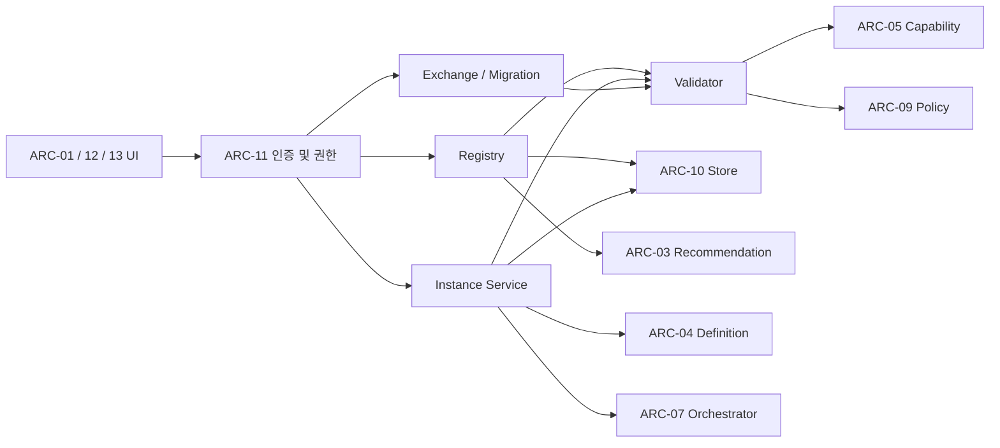
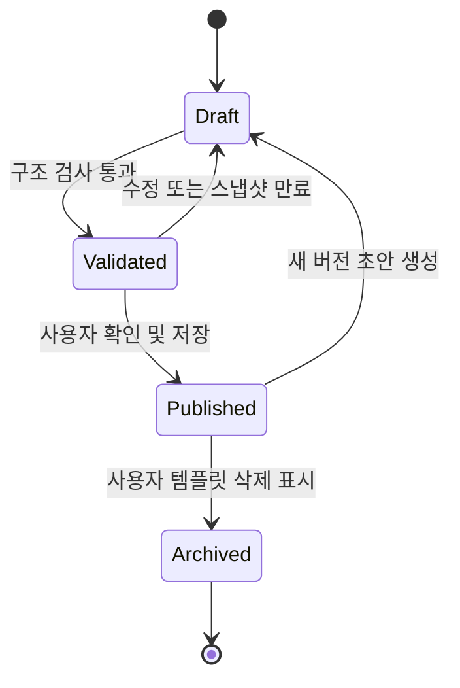
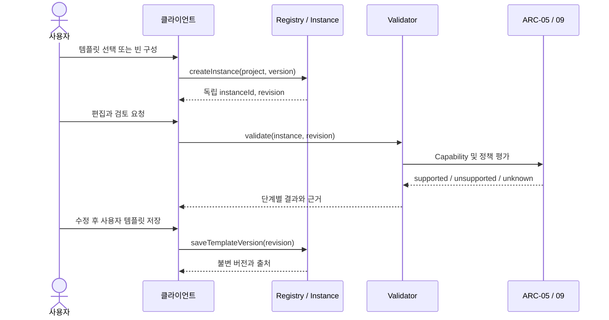

# ARC-15 Architecture Template & Registry System

상태: 상세 설계 초안 · 2026-11-16. 기준: ARC-00 v0.3, TEMPLATE_SYSTEM_OVERVIEW, ADR-015(제안). 논리적 계약과 초기 형식의 제안이며 구현·Provider 지원 검증이나 ADR 확정을 뜻하지 않는다. ARC-11의 인증·전송 계약은 제안 상태이고 ARC-10 저장 엔진은 결정되지 않았으므로 이 문서의 호출 표기는 HTTP/IPC 형식이 아니다.

## 1. 목적과 범위
기본 및 사용자 템플릿을 탐색·버전 관리하고, 독립적인 프로젝트 Architecture Instance를 생성·편집·검증·재사용한다. 가져오기·내보내기, 스키마 호환성 및 Runtime Capability 평가를 포함한다. 클라우드 동기화와 외부 마켓플레이스는 제외한다. 초기 기본 템플릿 후보와 실제 제공 여부는 ARC-00 v0.3을 따른다.

## 2. 책임 및 비책임
- Registry: 기본 템플릿 원본과 사용자 템플릿 계열·불변 버전·목록·검색·삭제 표시를 관리한다. 설치된 기본 템플릿 카탈로그 갱신은 ARC-14가 검증할 배포 경계다.
- Instance Service: 프로젝트별 독립 사본·낙관적 동시성·출처와 편집 버전을 관리한다. 프로젝트 식별·접근권한은 ARC-11의 검증된 컨텍스트에 따른다.
- Validator: 가져오기, 스키마, 그래프, Capability 및 정책 요구를 단계별로 평가한다. 실행 승인 또는 Provider의 실제 기능을 보증하지 않는다.
- Exchange/Migration: 비신뢰 입력을 격리해 검사하고 원본 보존·미리보기·승인을 거쳐 새로운 버전을 만든다.
- ARC-03은 추천과 설명, ARC-04는 Agent Definition의 의미 및 설정 변환, ARC-05/06은 설치·계정·Capability·실행, ARC-07은 작업 DAG, ARC-09는 승인 정책, ARC-10은 저장, ARC-11~13은 인증된 클라이언트·UI 경계를 소유한다.

## 3. 기능 및 비기능 요구사항
1. 이름·설명·사용 사례·역할·연결·흐름·요구 Capability·제약·버전을 가진 기본 후보와 사용자 템플릿을 구분해 검색·필터·미리보기한다. Blank는 템플릿 없이 새 인스턴스를 만드는 경로다.
2. 선택된 정확한 버전에서 프로젝트별 인스턴스를 만들고 이후 수정은 원본·다른 인스턴스에 전파하지 않는다. 사용자 템플릿 수정은 기존 버전을 덮어쓰지 않고 새 버전으로 발행한다.
3. 노드 추가·삭제·복제, 속성·연결·순서·분기 편집, 입출력·오류·재시도·승인 요구를 변경안으로 표현한다. UI의 실제 노드 표현은 ARC-01과 협의한다.
4. 저장·복제·가져오기·내보내기·삭제와 프로젝트 간 재사용은 권한·기대 버전·사용자 확인을 거친다. 가져오기와 미리보기는 명령·스크립트·외부 연결을 실행하지 않는다.
5. 추천은 후보일 뿐 구조 유효성·Capability·정책·사용자 실행 승인과 별개다. unknown이나 unsupported 필수 Capability에 의존하는 실행은 차단한다.
6. 로컬 Core가 정본을 소유하고 ARC-10에 쓰며 다중 클라이언트 충돌을 명시한다. 응답 시간·용량의 정량 목표는 측정 후 결정한다. 모든 크기·깊이·횟수 제한은 값이 확정되기 전 보안 시험에서 상한을 설정해야 하며 무제한 허용하지 않는다.

## 4. 구성요소와 흐름


## 5. 데이터 모델과 불변 조건
아래는 논리 모델이다. ID는 불투명하며 충돌하지 않아야 하고 물리 저장 스키마와 wire 형식은 미정이다. 설계 확정(Final, 2026-11-17): wire 형식은 W-block·S4로 확정. 물리 저장 스키마는 제품게이트.

| 객체 | 주요 속성 | 불변 조건 |
|---|---|---|
| TemplateFamily | templateId, familyRevision, origin(built-in/user/imported), 표시 이름, 삭제 표시 | built-in은 사용자 변경·삭제 불가. 사용자 계열 변경 시 familyRevision 증가; 삭제 표시는 인스턴스를 변경하지 않음 |
| TemplateVersion | templateId, versionId, schemaVersion, metadata, graph, requirements, createdAt, provenance | 발행 후 불변; versionId는 계열 내 고유; 변경은 새 버전 |
| ArchitectureInstance | instanceId, projectId, revision, graph snapshot, provenance(templateId/versionId 또는 blank), bindings | 생성 시 그래프를 복사; 출처가 삭제돼도 실행 구성은 보존; 변경마다 revision 증가 |
| AgentDefinition | definitionId와 ARC-04가 정하는 역할·입출력·도구·권한 | Runtime/모델·계정과 별개; ARC-04가 의미·변환 계약 소유 |
| RuntimeBinding | instanceId, nodeId, runtimeRef, modelRef, accountRef | 프로젝트 인스턴스에 귀속. accountRef는 불투명 참조이며 인증정보가 아님 |
| ValidationReport | 대상 ID/revision, schemaVersion, Capability snapshot ID/시간, 검증 결과·근거 | 스냅샷·정책 변경 시 stale; 보고서는 실행 승인 아님 |
| ImportCandidate | candidateId, 주체·workspace, 입력 출처·형식·원본 해시, 정규화 결과 해시, 검증기·정책 버전, 만료 상태 | 불신 상태이며 미리보기는 실행하지 않음; 임시 보관과 폐기 정책은 T1(24시간·삭제 규칙)로 확정 |

TemplateVersion에는 표시 이름·설명·사용 사례·태그, graph와 요구 Capability·제약을 포함한다. TemplateFamily 표시 이름은 검색용 메타데이터이며 버전의 표시 내용은 발행 시점에 고정한다. 템플릿 내용과 내보내기에서 토큰·API 키 등 비밀정보는 금지한다. 로컬 경로·계정 참조·실행 환경 식별자는 내보내기에서 기본 제외하는 방향으로 제안하고, 안전 검증과 명시적인 사용자 확인 없이 포함하지 않는다. 자동 비밀 탐지는 완전하지 않다.

## 6. 스키마와 그래프
교환 모델 v1 후보는 `schemaVersion`, `metadata`, `nodes`, `edges`, `requirements`의 논리적 묶음이다. `nodes`의 ID는 문서 내 유일, `edges`의 양 끝은 존재하는 노드와 호환되는 포트를 참조한다. 노드 후보 Agent·Task·Tool·Memory·Evaluation·Approval 중 v1 어휘는 S8·S2로 확정하고, 실행 지원 여부는 ARC-01/04/07과 제품게이트에서 검증한다. JSON/YAML은 같은 내부 모델로 정규화하며 실제 JSON Schema, YAML 부분집합 및 에러 위치 표현은 미결정이다. 설계 확정(Final, 2026-11-17): YAML 부분집합·dialect는 S6·S7로 확정. 정식 JSON Schema 발행·에러 위치 표현은 제품게이트. 임의 코드 실행이나 파일 참조 해석은 파서의 책임이 아니다.

ARC-07의 작업 의존성은 DAG다. 작업 의존 edge의 순환 및 서브그래프 참조 순환은 거부한다. 분기는 조건 언어와 실행 정책이 검증되기 전 `unknown`으로 표시해 실행 불가로 둔다. 반복은 유한 횟수·시간/비용 등 상한과 종료 조건을 표현하고 실제 집행을 증명하기 전 미지원이다. 서브그래프 재사용도 참조 해석·버전 고정·순환 검사와 한계가 정해지기 전 미지원이다. 이것은 무제한 반복 또는 전체 워크플로의 임의 순환을 허용하지 않는다.

## 7. 공개 논리 계약
모든 호출은 ARC-11의 인증된 clientId·주체·workspace/project 권한과 requestId를 필요에 따라 받는다. 실제 transport, 동시성 제어의 물리적 보장은 미확정이다. 변경 시 같은 requestId와 같은 입력은 이전 결과를 반환하고 다른 입력이면 충돌한다. ARC-10의 원자적 전이·이벤트 저장 요구가 충족되는지 후속 검증한다.

| 연산 | 입력 / 전제 | 결과 / 오류 |
|---|---|---|
| listTemplates | 검색·태그·origin·페이지 커서, 읽기 권한 | 접근 가능한 계열·버전 요약. 커서 만료·권한 오류 구별 |
| getTemplate | templateId, versionId | 불변 버전 또는 NOT_FOUND / ACCESS_DENIED |
| createInstance | projectId, 정확한 templateId/versionId 또는 blank, requestId | 새 instanceId·revision; 접근 거부·미지원 스키마·중복 요청 충돌 |
| updateInstance | instanceId, expectedRevision, 변경안, requestId | 새 revision; 버전 다르면 CONFLICT와 현재 revision, 기존 내용 유지 |
| saveTemplateVersion | instanceId/기대 revision 또는 기존 사용자 버전, 대상 사용자 계열과 기대 familyRevision 또는 새 계열 요청, metadata, requestId | 사용자 계열의 새 불변 버전; built-in 계열 변경 거부, 비밀·스키마 오류 |
| previewImport | 바이트·형식·크기, workspace 권한 | candidateId, 안전 검증·변경 미리보기; 실행·저장 적용 없음 |
| commitImport | candidateId, 검증 결과 버전, 사용자 확인, requestId | 새 사용자 버전; 검증 실패·만료·충돌 시 무변경 |
| exportTemplate | 정확한 사용자/기본 버전, 허용 포맷 | 비밀·환경 바인딩을 기본 제외한 교환 파일 또는 안전 검증 실패 |
| deleteTemplate | 사용자 templateId, expectedFamilyRevision, 사용자 확인 | 계열 숨김/삭제 표시와 familyRevision 증가. 과거 인스턴스와 버전 근거 유지; built-in 거부 |
| validate | 대상 ID/revision, 설치 Capability snapshot, 정책 버전 | 구조·호환성·정책 요구별 결과와 근거, 검증 시각·stale 여부 |

`previewImport`는 후보 임시 보관을 허용하지만 정본 템플릿이나 프로젝트 인스턴스를 생성하지 않는다. 후보가 디스크에 보관되면 비신뢰 사용자 데이터로 분류하고 ARC-10 접근 통제와 보관 제한을 적용한다. 입력의 해시·검증 결과와 실제 저장할 정규화 결과를 분리해 기록하며, 원문에 비밀이 있을 수 있으므로 원본 바이트를 영구 보관한다고 가정하지 않는다.

`commitImport`는 후보 소유 주체·workspace, 만료, 원본/정규화 결과 해시, 검증기 및 정책 버전, 사용자가 확인한 대상 계열·변경 내용과 기대 familyRevision을 재검사한다. 어느 하나라도 변경되거나 확인되지 않으면 후보를 적용하지 않고 새 미리보기와 확인을 요구한다. 후보 ID나 해시 자체는 권한 또는 신뢰 증명이 아니다. 별도 사용자 확인은 실행 승인이나 외부 전송 승인을 부여하지 않는다.

삭제된 템플릿의 보존 기간, 물리적 삭제와 개인정보 삭제 정책은 ARC-10/09 후속 결정이다. 보존을 무기한 보장하지 않으며 참조 중인 인스턴스의 실행 구성은 스냅샷으로 독립한다. 내보내기는 공유나 외부 전송이 아니며, 파일 저장·공유 대상과 권한은 플랫폼별 정책을 따른다.

기본 템플릿을 사용자 정의로 복제할 때는 원본 계열에 버전을 추가하지 않고 사용자 소유의 새 계열을 생성한다. 새 버전의 대상 계열은 쓰기 권한과 기대 familyRevision을 검사한다. 요청 중복 판정은 인증 주체·workspace·연산 종류·requestId를 함께 범위로 삼고 정규화 입력의 일치 여부를 확인한다. 결과 보존 및 만료 후 거부는 ARC-10 v0.2와 ARC-11의 제안 계약을 따르며 저장 원자성의 실제 보장은 미검증이다.

## 8. 상태 전이와 동시성


이 상태는 사용자 템플릿 버전의 생명주기다. Published는 불변이며 새 Draft는 새 버전 후보이다. 기본 템플릿은 사용자 Draft·Archived로 전환하지 않는다. 인스턴스는 revision과 별도 validation report로 관리한다. 저장 중 충돌은 변경을 적용하지 않고 재조회·비교하도록 반환한다. 게시와 이벤트의 원자성은 ARC-10 저장 계약에 의존하며 실제 보장 전 검증 필요하다.

## 9. 검증 파이프라인과 실행 게이트
1. **안전한 읽기**: 크기·깊이·리소스 제한, JSON/YAML 파서 안전 설정, YAML 사용자 정의 태그·외부 참조 및 실행형 생성 금지. 지원되는 YAML 별칭 정책은 S6으로 확정(v1 별칭 거부, 2026-11-17 Final). JSON/YAML 중복 키, 문자열이 아닌 맵 키, JSON 모델에 안전하게 매핑할 수 없는 값은 조용히 변환하지 않고 거부한다. 세부 허용 집합은 S6·S7로 확정(2026-11-17 Final).
2. **스키마**: 필수 속성·타입·알 수 없는 버전·중복 ID·알 수 없는 노드/필드를 확인한다. 미래 버전·의미를 모르는 필수 필드는 실행을 막는다. 원본 보존 및 안전한 내보내기 가능 여부는 별도 검사한다.
3. **구조**: edge 참조·포트 타입·작업 의존 DAG·서브그래프 순환·분기/반복 지원 및 상한을 검사한다.
4. **환경**: 요구 Capability와 설치 버전·계정 참조·권한의 지원 여부를 ARC-05/06의 최신 스냅샷과 비교한다. 각 요구는 supported/unsupported/unknown으로 표시한다.
5. **정책**: ARC-09가 위험 행위·파일·외부 전송을 판단한다. 실행 직전 대상 revision, 스냅샷 및 승인 범위를 재검증한다.

각 단계 결과는 `pass / fail / unknown`과 사유를 갖는다. 실행 가능 판정은 구조 pass, 필수 Capability supported, 정책 허용 또는 유효한 승인과 실제 집행 가능성이 모두 확인된 경우에만 가능하다. 보고서가 오래되거나 Provider가 바뀌면 재검증하며 추천 점수는 이를 우회할 수 없다. 선택·저장과 실행 승인은 서로 다르다.

## 10. 시나리오


AI 추천은 ARC-03이 후보·이유·대안을 제공하고 사용자가 선택한다. 수정안 적용은 인스턴스 revision을 검사하고 사용자 확인 뒤 수행한다. 가져오기는 previewImport → 스키마/안전 검사 → 사용자 확인 → commitImport 순서다. 실행은 이후 ARC-07/06과 ARC-09가 별도로 승인한다.

## 11. 오류 및 장애 복구
부분 업로드·파싱 실패·손상 파일은 사용자 템플릿이나 인스턴스를 바꾸지 않는다. 발행 중 저장 실패 시 성공을 반환하지 않고 재조회 후 requestId로 결과를 확인한다. 저장 응답 유실 시 중복 발행 여부가 확인되기 전 새 요청 ID로 재시도하지 않는다. 마이그레이션은 기존 버전을 보존하고 새 버전 후보·차이를 보여주며, 확인 후 저장 실패 시 원본은 그대로다. Capability 조회 장애는 unsupported가 아닌 unknown이다. 다중 클라이언트 충돌은 CONFLICT로 반환하고 자동 병합하지 않는다.

## 12. 보안 및 권한
외부 템플릿·프롬프트·웹페이지 데이터는 비신뢰 입력이며 시스템 명령이나 사용자 승인으로 해석하지 않는다. 파서의 코드 실행·외부 자원 접근을 금지하고 대상 경로·크기·깊이·리소스 제한을 검증한다. 명령·스크립트·도구 사용은 가져오기 중 실행하지 않으며 실행 전 ARC-09의 별도 정책·승인을 요구한다. 토큰·쿠키·API 키를 템플릿, 로그, 내보내기에 저장하지 않는다. 각 클라이언트는 ARC-11 인증 및 workspace별 최소 권한이 필요하며 Chrome 웹페이지는 Core를 직접 신뢰 호출하지 못한다. Provider 공식 인증은 ARC-05 경계에 남는다.

## 13. 테스트 전략 및 Definition of Done
- 계약: 기본 원본 수정 거부, 버전 불변, 인스턴스 복사 독립성, 삭제 후 참조 보존, 권한 없는 클라이언트 거부.
- 동시성·복구: 동일/상이 requestId, 기대 revision 불일치, 응답 유실, 저장 실패와 마이그레이션 중단 시 원본 유지.
- 검증: 중복 ID·없는 포트·타입 불일치·DAG 순환, 서브그래프 순환, 상한 없는 반복, 미래 스키마, unknown Capability와 stale 보고서.
- 보안: JSON/YAML 대용량·깊이·별칭·태그·외부 참조·악성 명령·비밀 및 경로, 승인되지 않은 외부 전송.
- UX/통합: 세 클라이언트의 권한 차이, 선택·편집·저장·추천·실행 승인 분리 및 접근성 검토. 실제 플랫폼 지원은 ARC-11~14와 별도로 검증한다.

설계 문서의 완료 조건은 위 요구·논리 계약·오류·상태·보안과 검증 가능 기준의 ARC-01/03/04/05/07/09/10/11 교차 검토 및 사용자 승인이다. 구현 테스트와 Provider별 실제 지원 검증은 별도 개발 단계의 게이트이며 이 문서의 완성이 그것을 증명하지 않는다.

## 14. 관련 ADR, 의존 관계 및 미결정
ADR-004·008·009·010·012, 제안 ADR-014·015에 관련된다. ARC-11의 인증·클라이언트 정책과 ARC-10의 저장 경계는 선행 합의가 필요하며 현재 논리적 가정이다. ARC-03 추천, ARC-04 정의, ARC-05 Capability, ARC-07 DAG, ARC-09 승인과 교차 검토한다. JSON Schema와 YAML 부분집합·구체 크기 상한, 노드/포트 목록, 스키마 호환·마이그레이션 알고리즘, 저장 구현, 실행 시점의 승인 전달·취소, 클라이언트별 편집 범위와 제안된 데이터 삭제·보존 정책의 구현 및 검증은 미정이다.

설계 확정(Final, 2026-11-17): S4·S5·S6·S7·S8·S9·S10·T5·T8 확정. 승인 전달은 기존 계약+D06·T3 유지. 정식 스키마 발행·저장 구현·클라이언트별 편집 범위·삭제보존 구현검증·에러 위치 표현은 제품게이트. 정본은 [설계 확정 기록 §6](DESIGN_FINALIZATION.md).

## 15. 교환 모델의 검토용 예시와 해석 규칙

아래 JSON은 **확정된 JSON Schema나 실행 가능한 템플릿이 아닌 예시**다. 2026-11-17 동결(S4): 정식 버전 표기는 구조화 {major, minor}이며 아래 예시도 구조화 표기를 사용한다. 노드 종류·Capability 이름은 ARC-04/05와 정합성 검증 전이므로 예시의 `example.*`는 실제 Provider 기능으로 사용하지 않는다. 계정 참조와 로컬 경로는 포함하지 않는다.

```json
{
  "schemaVersion": {"major": 1, "minor": 0},
  "metadata": {
    "name": "검토 예시",
    "description": "단일 Agent 구조의 예시",
    "tags": ["example"],
    "useCases": ["작은 단일 작업"]
  },
  "nodes": [
    {
      "id": "agent-1",
      "kind": "agent",
      "label": "작업 담당",
      "definition": {
        "schemaVersion": {"major": 1, "minor": 0},
        "definitionId": "definition-example-1",
        "revision": 1,
        "role": "사용자 목표 처리",
        "instructions": "사용자가 승인한 범위에서 작업을 수행한다.",
        "inputs": [],
        "outputs": [],
        "tools": [],
        "permissions": [],
        "resourceLimits": {"maxDurationSeconds": 60, "maxAttempts": 1}
      },
      "requirements": [{"capability": "example.agent", "required": true}]
    }
  ],
  "edges": [],
  "requirements": {"capabilities": [], "permissions": []}
}
```

이 예시는 교환 내용만 나타낸다. Registry의 templateId/versionId, 생성 시각 및 가져오기 출처는 신뢰할 수 없는 파일의 값으로 로컬 식별자를 덮어쓰지 않고 Core가 별도로 부여·기록한다. 이름과 태그는 표시 문자열이며 권한·경로·명령으로 해석하지 않는다. 동일한 콘텐츠를 여러 번 가져오더라도 중복 여부는 사용자에게 표시하고, 해시 일치만으로 권한·출처가 같다고 판단하지 않는다. YAML 입력은 동일한 의미 모델로 바꾸되 태그와 별칭은 9절의 제한을 따른다.

### 호환성 및 버전 판정안

- 버전 문자열은 `major.minor` 형식을 후보로 한다. 입력이 모르는 major면 `UNSUPPORTED_SCHEMA`로 실행과 게시를 거부한다. 더 높은 minor의 알 수 없는 필드가 의미에 영향을 미칠 가능성을 배제할 수 없으면 `UNKNOWN_SCHEMA_FEATURE`로 실행을 막는다. 호환성 보장은 실제 스키마와 마이그레이션 검증 후 결정한다.
- 제품 교환 형식의 `schemaVersion`은 JSON Schema 표준의 dialect를 뜻하지 않는다. JSON Schema를 채택하면 사용하는 dialect의 `$schema`와 제품 형식 버전을 별도로 선언·관리하고, 원격 `$ref` 자동 다운로드를 허용하지 않는다. 구체 dialect와 로컬 스키마 배포는 S7(Draft 2020-12·로컬)로 확정(2026-11-17 Final). [JSON Schema 공식 문서](https://json-schema.org/understanding-json-schema/reference/schema)
- 같은 schemaVersion이어도 TemplateVersion 식별자와 Instance revision은 서로 독립한다. 저장된 인스턴스가 참조하는 출처 버전이 삭제 표시돼도 인스턴스의 그래프 스냅샷을 유지한다.
- 변환은 `sourceVersion → targetVersion`과 변경점, 보존 불가 요소를 미리 보고 사용자 확인을 받는다. 대상 형식을 안전하게 해석하지 못하면 변환하지 않는다. 실패 시 이전 버전과 인스턴스를 변경하지 않는다.
- validation report는 대상 revision, Capability snapshot, 정책 버전이 하나라도 바뀌면 stale이다. 시간 만료 기준은 T8(24시간)로 확정(2026-11-17 Final). 실행 전 재조회·재검증 의무는 유지한다.

### 오류 분류안

| 코드 | 의미 | 호출자의 다음 동작 |
|---|---|---|
| ACCESS_DENIED | 주체·workspace·행위가 허용되지 않음 | 권한 범위를 표시하고 승인 절차 확인; 재시도로 우회하지 않음 |
| CONFLICT | 기대 revision 또는 요청 ID의 내용이 다름 | 최신 버전을 다시 읽고 차이를 검토; 자동 덮어쓰기 금지 |
| INVALID_INPUT | 구문·필수 값·참조·크기 제한 위반 | 실패 위치와 비민감 사유 표시; 적용하지 않음 |
| UNSUPPORTED_SCHEMA | 알 수 없는 major 또는 변환 경로 없음 | 원본을 변경하지 않고 적합한 버전 확인 |
| UNKNOWN_SCHEMA_FEATURE | 의미를 해석할 수 없는 필드·노드 | 실행 차단 및 호환성 검토 |
| CAPABILITY_UNSUPPORTED | 필수 기능이 지원되지 않는 것으로 확인됨 | 사용자에게 대안 제시; 승인 없이 자동 변환 금지 |
| CAPABILITY_UNKNOWN | 필수 기능을 확인할 수 없음 | 실행 차단 후 Provider·버전 재확인 |
| APPROVAL_REQUIRED | 정책상 별도 사용자 확인 필요 | 구체적 행위·대상·범위를 표시하고 ARC-09로 요청 |
| STORAGE_UNAVAILABLE | 정본 저장 실패 또는 결과 불명 | 새 작업 중지, requestId로 결과 재조회; 무조건 재시도 금지 |

오류 코드는 논리적 분류로서 ARC-11의 실제 transport 상태 코드나 직렬화 형식은 확정하지 않는다. 파일·권한·계정 존재 여부가 노출되지 않도록 접근 거부 응답의 정보 범위는 ARC-09/11과 확정한다.

## 16. 검증 결과 조합과 동시성 사례

| 구조 검사 | 필수 Capability | 정책 및 집행 | 표시 결과 | 실행 |
|---|---|---|---|---|
| fail | 임의 | 임의 | 구조 오류 | 차단 |
| pass | unsupported | 임의 | 지원되지 않는 필수 기능 | 차단 |
| pass | unknown | 임의 | 지원 확인 필요 | 차단 |
| pass | supported | deny 또는 unknown | 정책 거부 또는 확인 필요 | 차단 |
| pass | supported | approval_required, 승인 없음 | 승인 필요 | 차단 |
| pass | supported | 허용 또는 유효한 승인, 집행 가능 확인 | 실행 가능 | 실행 직전 재검증 후 요청 가능 |
| unknown | 임의 | 임의 | 구조 확인 필요 | 차단 |

실행 가능은 실행 성공이 아니다. ARC-06의 시작 기록·외부 프로세스 경계는 원자적이지 않으며 ARC-07의 작업 성공은 실행 이후 평가에 달려 있다. 선택적 Capability의 미지원이 반드시 전체를 막는지 여부와 대체 경로는 템플릿의 명시적 제약에 따라 표시하고, 대체는 자동 적용하지 않는다.

동시 수정 예: 클라이언트 A와 B가 revision 3을 읽고 각각 변경한다. A가 먼저 revision 4를 저장하면 B의 expectedRevision 3 저장은 CONFLICT로 실패한다. B는 4를 다시 읽고 차이를 사용자에게 보여준 뒤 새로운 요청 ID와 revision 4로 명시적으로 제출한다. A의 응답이 유실됐다면 A는 기존 requestId로 결과를 재조회하며, 요청 중복 기록의 보존 기간이 지났거나 저장소 상태가 불명확하면 중복 발행 여부를 확인하기 전 자동 재실행하지 않는다.

## 17. 근거와 검증 범위

[YAML 1.2.2 명세](https://yaml.org/spec/1.2.2/)는 2021-10-01 개정본으로 태그와 앵커·별칭을 언어 요소로 정의한다. ARC-15의 별칭 거부, 외부 참조 금지와 크기 제한은 이 제품을 위한 보수적 제안이며 특정 파서의 안전 보장이 아니다. [JSON Schema의 dialect 선언](https://json-schema.org/understanding-json-schema/reference/schema)은 `$schema`가 스키마 dialect를 선언한다고 설명한다. 제품의 `schemaVersion`과 별도로 관리하는 규칙은 이 문서의 제안이다. [SQLite 원자적 커밋 설명](https://www.sqlite.org/atomiccommit.html)은 저장 모드와 환경 가정을 설명하며, 제품 전체의 외부 실행까지 하나의 트랜잭션으로 보장하지 않는다. 확인일은 2026-11-16이며 구현·정책은 다시 확인해야 한다.

## 18. 가져오기·게시 계약의 수용 사례

| 사례 | 사전 조건과 행위 | 기대 결과 |
|---|---|---|
| 후보 내용 변경 | 후보 A를 미리 본 뒤 다른 바이트 또는 정규화 결과 B를 같은 후보로 게시 | 해시 불일치로 거부, Registry와 Instance는 변경되지 않음 |
| 권한 또는 정책 변경 | 후보 확인 후 workspace 접근 철회 또는 정책 버전 변경 | 기존 확인을 재사용하지 않고 거부하거나 새 미리보기·확인을 요구 |
| 중복 키 | `metadata` 등의 동일 키를 한 객체에 두 번 가진 JSON 또는 YAML | 파서가 마지막 값을 조용히 채택하지 않고 INVALID_INPUT 반환 |
| 사용자 계열 동시 게시 | A·B가 familyRevision 4를 읽고 서로 다른 버전을 게시 | 한 요청만 성공, 다른 요청은 CONFLICT; 성공한 버전은 불변 |
| 응답 유실 | 저장은 성공했으나 응답이 유실됨 | 동일한 주체·workspace·연산·requestId와 동일 입력은 보존 기간 내 기존 결과 반환; 다른 입력은 CONFLICT |
| 기본 템플릿 수정 | built-in 계열을 수정·삭제하려 함 | 원본 변경은 거부; 사용자 소유 새 계열로 복제 가능 |
| 환경 바인딩 내보내기 | 인스턴스에 계정 참조·로컬 경로가 포함됨 | 기본적으로 해당 값을 제거하고 비밀 검사를 거침; 자동 탐지가 완전하다고 표시하지 않음 |

이 사례는 구현해야 할 수용 기준이다. 현재 문서 검토만 수행했으며 테스트가 통과했다는 뜻이 아니다. 상세 형식과 실제 원자성은 ARC-10/11 확정 및 구현 후 검증한다.

## 19. 그래프 의미와 실행 계획의 경계

아래는 후속 ARC-04/07 교차 검토를 위한 **초기 논리 분류**다. Canvas의 선이 모두 작업 의존성이라는 뜻은 아니며, 이 분류 자체가 Provider 또는 실행기의 지원을 보장하지 않는다.

| 관계 후보 | 출발 → 도착 | 의미 | 검증과 실행 변환 |
|---|---|---|---|
| 의존성 | Task → Task | 후행 작업은 선행 작업의 성공 판정을 필요로 한다 | 방향 그래프에 포함해 순환을 검사하고 ARC-07로 전달한다. 선행 실패·취소·미확인은 자동 성공으로 바꾸지 않는다. |
| 데이터 연결 | 출력 포트 → 입력 포트 | 한 구성요소의 출력을 다른 입력에 연결한다 | 양쪽 포트 존재와 방향·계약 호환을 검사한다. 데이터 전달만으로 실행 순서를 암묵적으로 확정하지 않으며 필요한 의존성이 없으면 실행 계획을 보류한다. |
| 역할 바인딩 | Task → Agent | 작업 수행 역할을 지정한다 | Agent Definition과 Runtime Binding이 존재하는지 확인한다. 여러 역할 할당·선택 규칙은 미정이며 모호하면 차단한다. |
| 도구·기억·평가 참조 | Agent 또는 Task → Tool/Memory/Evaluation | 사용할 구성요소 및 평가 요구를 참조한다 | ARC-04/08/09의 권한·의미를 확인한다. 참조만으로 도구 호출이나 기억 전송을 허가하지 않는다. |
| 승인 요구 | Task 또는 위험 행위 → Approval | 지정 범위의 사용자 승인이 필요하다는 요구를 표현한다 | ARC-09의 승인 요청으로 변환한다. 시각적 노드 자체는 승인 증거가 아니다. |

Agent 포트의 최초 타입과 연결 제약은 아래 v0.2 제안을 따른다. 다른 노드의 포트 이름·타입은 S2로, 조건식 언어는 v1 실행 UNSUPPORTED(S8)로 확정한다. 다중 연결·병합 의미 미정의는 UNKNOWN·차단(기존 규칙 유지). 노드별 정확한 직렬화는 제품게이트. Validator는 의미를 알 수 없는 관계를 장식으로 버리지 않고 `unknown`으로 보고 실행 계획 생성을 차단한다. 좌표·색상 등 UI 전용 배치 정보는 실행 권한이나 의미에 영향을 주지 않도록 논리 그래프와 구분하며, 실제 교환 형식에서는 미포함으로 확정한다(S10, 2026-11-17 Final).

### 계획 수립 및 변경 보호

1. Validator는 인스턴스 revision과 정의된 관계 종류를 고정해 구조를 확인한다. ARC-04의 정의·포트 계약과 ARC-05 Capability의 버전이 없거나 확인되지 않으면 해당 결과를 unknown으로 남긴다.
2. ARC-07은 승인된 revision에서 작업 의존 그래프를 생성하고 순환·미해결 참조·의존성 누락을 검사한다. Validator와 Orchestrator의 결과가 충돌하면 실행하지 않고 원인을 반환한다.
3. 사용자가 노드·연결·바인딩을 수정하면 인스턴스 revision이 바뀐다. 이전 검증 보고서와 변경 전 실행 승인은 자동으로 새 revision에 적용되지 않는다.
4. 병렬 후보는 의존성이 없다는 사실만으로 안전하다고 확정하지 않는다. 공유 파일·도구·계정에 대한 접근 충돌과 격리는 ARC-07/09 및 Provider Capability에 따라 별도 확인한다.

### 수용 사례

- A의 결과를 B의 입력에 연결했지만 작업 의존성이 없다면 데이터 관계를 근거로 B가 준비됐다고 판단하지 않고 실행 계획을 보류한다.
- Task A → B와 B → A의 의존 edge가 있으면 순환 오류를 반환하고 실행하지 않는다. 별도 승인으로 이 검사를 우회할 수 없다.
- revision 4에 대한 승인 이후 연결을 수정해 revision 5가 되면 revision 4의 검증과 승인을 재사용하지 않는다.
- 두 독립 작업이 같은 파일을 수정할 수 있다면 독립 DAG라는 이유만으로 병렬 실행을 보장하지 않고 충돌 정책 확인을 요구한다.

이 사례들은 문서 수준의 수용 기준이며 실제 실행 엔진 테스트는 아직 수행하지 않았다.

## 보완 계약 v0.2: Agent 정의 연결

Agent 노드와 포트의 최초 교환 의미, 버전 호환, Adapter MappingReport 및 손실별 차단 규칙은 [ARC-04 보완 계약](ARC-04.md)을 따른다. Registry는 인스턴스 revision, templateVersion, 참조된 definitionId/revision을 보존하고 Validator는 같은 revision과 Capability snapshot을 ARC-04에 전달한다. ARC-04는 정의·포트·변환 의미의 정본이고 ARC-15는 템플릿 graph·인스턴스와 검증 보고서를 소유한다. `INVALID_REFERENCE`, `PORT_MISMATCH`, `UNSUPPORTED_SCHEMA`, `CAPABILITY_UNKNOWN`은 Validator가 대상·필드·사유와 함께 반환하며 자동 변환 또는 실행 승인을 하지 않는다. Task·Tool·Memory·Evaluation·Approval 노드의 세부 포트 및 분기·반복의 실행 의미는 여전히 미지원/미확인이다. 이 제안은 기존 예시를 실제 JSON Schema로 승인하거나 Provider Adapter가 동작함을 뜻하지 않는다.

## 후속 그래프 의미 검토 제안

Agent 외 Task·Tool·Memory·Evaluation·Approval의 소유·입출력·실패와 graph 관계를 [템플릿 그래프 의미 v1](TEMPLATE_GRAPH_SPEC_V1.md)에서 논리 계약으로 제안한다. 실행 지원이나 정식 교환 스키마 승인, 기존 미검증 기능의 통과를 의미하지 않는다.
