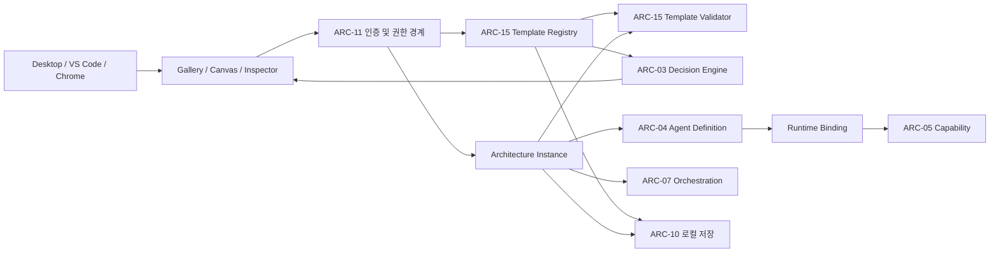

# Architecture Template System 상위 요구사항

상태: 상위 설계 제안 · 2026-11-16. ARC-15 상세 설계 또는 구현이 아니다. 기준은 ARC-00 v0.1 및 v0.2 멀티 클라이언트 부록이다.

## 범위와 사용자 흐름
기본 후보는 Single Agent, Prompt Chaining, Routing, Parallel Workers, Orchestrator-Workers, Evaluator-Optimizer 및 빈 Custom Architecture다. 실제 기본 제공 범위는 검증 후 결정한다. 사용자는 Gallery에서 설명·적합 사례·역할·관계·흐름·필요 Capability·제약·버전을 보고 선택하거나 빈 구성으로 시작한다. 선택 시 별도 Architecture Instance를 만들고 이를 복제·수정·검증한다. 기본 원본은 변경하지 않는다.

편집 UX 후보는 Agent, Task, Tool, Memory, Evaluation과 승인 단계의 관계·순서·병렬·조건 분기를 표시하는 노드 캔버스와 속성 패널의 조합이다. 역할·지시사항, Provider/Model/Runtime, 입출력 계약, 오류·재시도 정책은 속성으로 편집할 수 있다. 모든 속성을 노드로 만들지는 않으며 접근성·화면 복잡도와 각 플랫폼의 기능 범위는 후속 검증한다.

사용자는 현재 인스턴스를 이름·설명·태그와 함께 로컬 사용자 템플릿으로 저장하고 검색·필터·복제·수정·삭제·프로젝트 간 재사용·새 버전 생성을 할 수 있다. JSON/YAML 가져오기·내보내기는 스키마 버전과 호환성을 확인한다. 삭제는 해당 템플릿에 이미 연결된 인스턴스를 삭제하거나 변경하지 않는다. 클라우드 동기화와 외부 마켓플레이스는 후속 범위다.

추천은 목표와 제약·Project Profile·Capability를 입력으로 Registry 후보를 찾고 단순한 대안, 근거와 제한을 표시한다. 사용자가 선택한 뒤 AI가 수정안을 제안할 수 있으나 자동 적용하지 않는다. 별도의 Validator가 검사하고 사용자가 변경을 검토·승인한다. 추천, 구조적 유효성, 실행 가능성, 실제 실행 승인과 품질 평가를 서로 다른 결과로 표시한다.

## 논리 구성과 데이터 소유권

Template Definition은 불변 버전별 재사용 정의이고 Registry는 기본·사용자 템플릿의 탐색 및 관리 논리 소유자다. Architecture Instance는 프로젝트별 별도 사본이며 출처 템플릿 ID·버전을 참조할 수 있지만 이후 수정은 서로 전파되지 않는다. Agent Definition은 ARC-04가 소유하는 역할·도구·입출력·정책의 정의다. Runtime Binding은 인스턴스의 Agent Definition과 설치된 Runtime/Provider·모델·불투명 계정 참조를 연결하며 실제 Capability는 ARC-05/06이 판단한다. Template Validator는 템플릿/인스턴스의 구조·버전·참조·필요 기능과 정책 요구를 검사하지만 실행을 승인하지 않는다.

공유 로컬 Core가 Registry와 프로젝트별 인스턴스의 논리적 정본을 관리하고 ARC-10이 저장·버전·복구 수단을 제공한다. Desktop, VS Code 및 Chrome은 승인된 ARC-11 API를 통해 권한 범위 내에서만 읽거나 변경한다. 클라이언트 로컬 편집본은 초안이며 정본이 아니다. 수정에는 기대 버전을 전달하고 충돌 시 덮어쓰지 않고 다시 읽어 사용자에게 충돌을 제시한다. Core 위치와 원격 workspace 접근·클라이언트별 권한은 ARC-11~13 검증 전 미정이다. Chrome은 로컬 파일에 직접 접근한다고 가정하지 않는다.

## 스키마와 실행 호환성
내부의 Provider 중립 논리 모델을 기준으로 JSON/YAML은 버전이 명시된 교환 형식 후보로 취급한다. 구체 스키마, 필드, 서브그래프의 참조·확장 방식과 YAML 제한은 미정이다. 정의는 메타데이터, 버전, 역할 및 노드, 연결·입출력, 기본값, 요구 Capability·권한, 제약을 논리적으로 포함한다. 프로젝트 인스턴스의 사용자 override와 Runtime Binding은 원본을 변경하지 않고 별도로 유지한다.

작업 의존 그래프는 ARC-07의 DAG 제약을 따른다. 순환 참조와 무제한 반복을 허용하지 않는다. 반복·조건부 실행·재사용 서브그래프는 경계와 종료 조건·자원 상한을 표현할 수 있는지 별도 상세 설계 및 검증 전에는 미지원 또는 미확인으로 취급한다. 스키마 마이그레이션은 원본과 기존 인스턴스를 보존하고 버전·변경 내용 및 실패를 표시하며 사용자 승인 없이 파괴적 덮어쓰기를 하지 않는다. 불명확한 미래 버전은 실행을 차단하고 안전한 보기·내보내기 가능성은 확인 후 제공한다.

필요 Capability와 ARC-05의 설치·버전별 supported / unsupported / unknown을 비교한다. 필수 기능의 미지원·미확인은 실행 불가 또는 확인 필요로 표시하며, 대체 경로는 별도 검증·사용자 승인 없이는 자동 적용하지 않는다. 연결 구조의 유효성은 Runtime 실행 가능성을 보장하지 않는다.

## 보안과 검증
템플릿과 내보내기 파일에 토큰·API 키 등 자격증명을 저장하지 않는다. 계정 참조 및 로컬 경로 등 환경 의존 값의 내보내기 범위는 최소화·검토하고 비밀정보 필터가 완전하다고 가정하지 않는다. 외부 가져오기는 비신뢰 데이터이며 크기·깊이·참조·스키마를 검증하고, 명령·스크립트·도구 사용은 가져오기나 미리보기 중 실행하지 않는다. 실행 시 ARC-09 정책 검사와 별도 사용자 승인이 필요하다. YAML의 별칭·태그와 파서 안전 설정 및 악성 입력 제한은 후속 검증한다.

후속 검증은 기본 원본 불변·복제 독립성, 저장/삭제 후 인스턴스 보존, 다중 클라이언트 버전 충돌, JSON/YAML 라운드트립과 구·신버전 마이그레이션, 순환 참조·무제한 반복, unknown Capability, 악성 가져오기와 비밀 누출, 승인 우회를 포함한다. 이는 계획이며 실험 완료가 아니다.

## 관련 모듈
ARC-01은 Gallery·시각 편집과 사용자 승인 UX, ARC-03은 추천과 설명, ARC-04는 Agent Definition 및 설정 변환, ARC-07은 작업 의존성·스케줄링, ARC-05/06은 Capability와 실행, ARC-09는 정책, ARC-10은 저장을 유지한다. ARC-11~13은 인증된 멀티 클라이언트 연결과 플랫폼별 UX를 담당한다. ARC-15는 템플릿 생명주기·호환성 검증·정본을 소유한다. 물리 API·상세 알고리즘을 이번 단계에서 확정하지 않는다.
